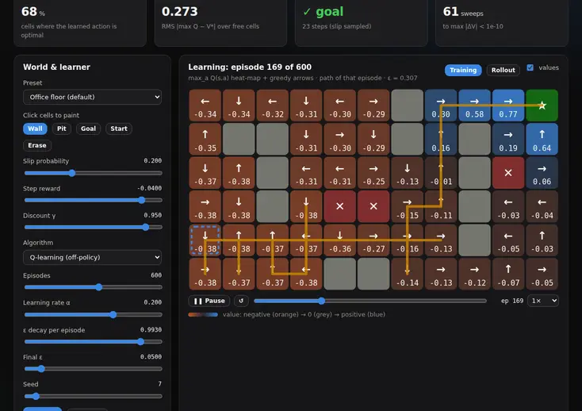
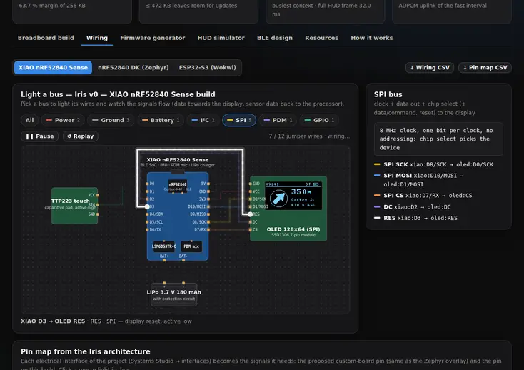
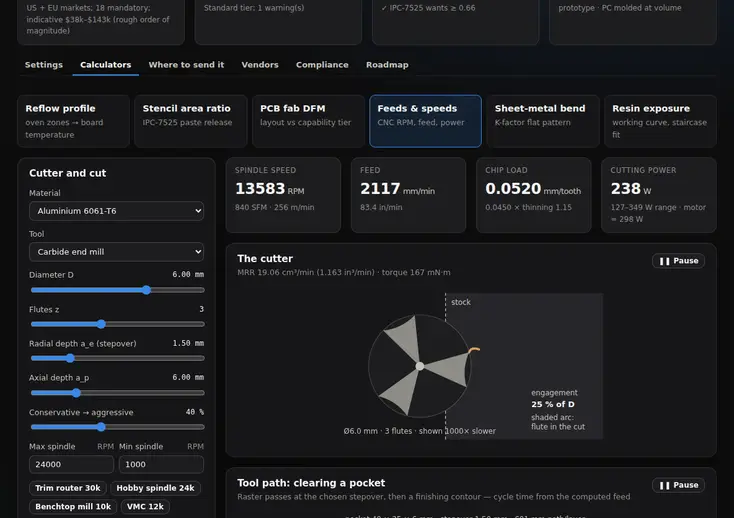
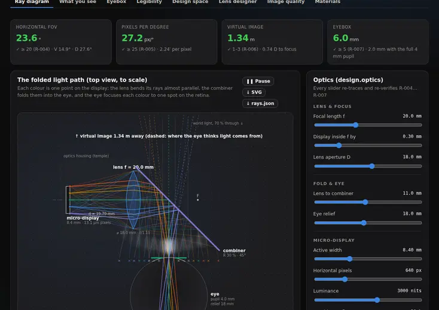
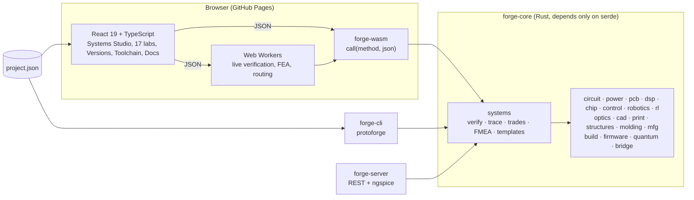

<div align="center">

# Protoforge

### Idea → atoms. An open, browser-native systems-engineering workbench that takes a product from a one-line idea to a tested prototype and factory-ready files.

**React front end · Rust engine compiled to WebAssembly · 17 engineering labs · runs entirely on GitHub Pages**

[](https://github.com/Normansrule/protoforge/actions/workflows/ci.yml)
[](https://github.com/Normansrule/protoforge/actions/workflows/pages.yml)


**[▶ Open the live app](https://normansrule.github.io/protoforge/)** · [Getting started](docs/getting-started.md) · [Architecture](docs/architecture.md) · [Systems Studio](docs/systems-studio.md) · [Web toolchain](docs/toolchain.md) · [Versions](docs/versions.md) · [References](docs/references.md)


</div>

---

## What is this?

Building a physical product means crossing a dozen disciplines — circuits, signal processing, chips, firmware, control, optics, mechanical strength, 3D printing, printed circuit boards, molding, compliance and cost — and keeping all of them honest against one list of requirements. Protoforge puts that whole journey into one web page:

1. **Describe the product** in the **Systems Studio**: problem, stakeholder needs, requirements, architecture, trade studies, risks and milestones.
2. **Bind every requirement to a number a simulation computes** — `R-012: rail droop ≤ 50 mV` is checked by the Circuit Lab's transient simulation, `R-026: safety factor ≥ 2` by the Structures Lab's finite element analysis.
3. **Design in 17 labs.** Each is a real simulator, generator or calculator written in Rust, with interactive visuals, animations and the maths explained with references. Every change re-verifies every requirement in the background.
4. **Hand each design to real tools** — KiCad, Falstad CircuitJS, OpenSCAD, Onshape (STEP), Quirk, IBM Quantum Composer, Wokwi, Ray Optics Simulation — with files our engine generates and independent parsers verify.
5. **Version it like Onshape**: named versions, branches, three-way merges and design reviews that show which requirement verdicts changed.
6. **Build it**: a breadboard prototype from development boards with generated firmware, ideal process settings for every machine, where to send each part, a compliance plan, and a one-click **fabrication package** (Gerbers, bill of materials, placement file, KiCad project, STEP, STL, G-code, firmware, reports and ordering guides).

The worked example is **Iris** — monocular heads-up-display smart glasses designed from scratch. **34 of its 35 requirements are verified by simulation**; the last is an honestly open optical goal. Along the way the labs caught real design bugs ([see below](#what-the-simulations-caught)).

> Everything runs in your browser — nothing is uploaded, no server is needed. The same Rust engine also runs as a command-line tool (used in continuous integration) and as a local REST server.

<div align="center">

<br/><sub><b>Run full verification</b> in the Systems Studio: every lab's analysis runs in Rust and each requirement lights up in V-model order.</sub>
</div>

---

## Contents

- [Build Iris step by step (animated walkthrough)](#build-iris-step-by-step)
- [The labs](#the-labs)
- [Real web tools, one click away](#real-web-tools-one-click-away)
- [Versions like Onshape](#versions-like-onshape)
- [Iris: the requirement table](#iris-the-requirement-table)
- [What the simulations caught](#what-the-simulations-caught)
- [Build anything: your own product](#build-anything-your-own-product)
- [Quick start](#quick-start) · [Command-line tool](#command-line-tool) · [REST server](#rest-server)
- [Architecture](#architecture)
- [Honest scope](#honest-scope-what-is-real-and-what-is-approximate)
- [Reference projects and further learning](#reference-projects-and-further-learning)
- [Repository layout](#repository-layout) · [Contributing](#contributing)

---

## Build Iris step by step

Every step below is a page of the live app. The clips are recorded from the real pages; open the app to drive them yourself.

<table>
<tr><td width="50%">

**1 · Define the product and verify it** — Systems Studio (`#/systems`)

Write the problem, the needs and the requirements; bind each requirement to a metric. Press *Run full verification* and watch every lab report in.

</td><td></td></tr>
<tr><td></td><td>

**2 · See the whole pipeline** — Overview (`#/`)

The systems-engineering “V” as a live flow: each lab group shows how many of its requirements pass; click a node to open it.

</td></tr>
<tr><td>

**3 · Simulate the electronics** — Circuit Lab (`#/circuit`)

A SPICE-style simulator in Rust. Presets for the Iris power rail, buck converter, battery sense, touch sensing and more, with current visibly flowing — or draw your own circuit in the **schematic editor**.

</td><td></td></tr>
<tr><td></td><td>

**4 · Draw circuits like Falstad or EasyEDA** — Circuit Lab → Schematic editor

Place parts, wire them, and the engine turns the drawing into a netlist and simulates it live. Export the netlist for ngspice or open it in Falstad CircuitJS.

</td></tr>
<tr><td>

**5 · Budget power and heat** — Power & Thermal (`#/power`)

Duty-cycle energy budget from the bill of materials, battery discharge, and a thermal network that predicts the temperature against your skin.

</td><td></td></tr>
<tr><td></td><td>

**6 · Lay out and route the board** — PCB Studio (`#/pcb`)

Placement with simulated annealing, a Lee maze autorouter (watch the wavefront flood), design-rule check, and Gerber / drill / BOM / placement exports.

</td></tr>
<tr><td>

**7 · Design the optics** — Optics Lab (`#/optics`)

Paraxial ray tracing of the display path, then **Optics Pro**: exact sequential ray tracing through real glasses and plastics, spot diagrams, modulation transfer function (MTF) and a damped-least-squares lens optimiser.

</td><td></td></tr>
<tr><td></td><td>

**8 · Model the frame** — CAD Studio (`#/cad`)

A parametric frame generated from eyewear sizes (lens width – bridge – temple length), with pods for the electronics and battery, mass properties and STL / OBJ / 3MF / STEP export.

</td></tr>
<tr><td>

**9 · Check it won't break** — Structures Lab (`#/structures`)

Voxel finite element analysis (FEA) of the real CAD parts under wear loads, animated deformation and von Mises stress, safety factors, fatigue life of the hinge, and Monte Carlo tolerance stack-ups.

</td><td></td></tr>
<tr><td></td><td>

**10 · Let the computer design the bracket** — Structures Lab → Topology optimisation

Solid Isotropic Material with Penalisation (SIMP), after the classic “88 lines” paper: material grows only where it carries load. Export the result as SVG or an OpenSCAD extrusion.

</td></tr>
<tr><td>

**11 · Process the audio and design the chip** — DSP Lab & Chip Lab (`#/dsp`, `#/chip`)

The pulse-density-modulation microphone chain, a two-microphone beamformer, logic minimisation, a touch-gesture state machine and a filter-to-Verilog generator with a Tiny Tapeout wrapper.

</td><td></td></tr>
<tr><td></td><td>

**12 · Track the head and learn a power policy** — Control, Robotics & RL Labs

Complementary and Kalman filters on a simulated inertial measurement unit (IMU), PID and LQR control, a SCARA robot that assembles the board, and reinforcement learning of a battery-saving policy.

</td></tr>
<tr><td>

**13 · Build a breadboard prototype** — Prototype & Firmware (`#/proto`)

Iris v0 from real development boards (Seeed XIAO nRF52840 Sense, nRF52840 DK, or an ESP32-S3 you can run in Wokwi): animated wiring by bus, a pin map, and generated Zephyr / Arduino firmware.

</td><td></td></tr>
<tr><td></td><td>

**14 · Design what the wearer sees** — Prototype & Firmware → HUD simulator

Navigation, live captions and notifications rendered pixel-exact at 640 × 400 with the firmware's font, plus the SPI frame budget and Bluetooth Low Energy (BLE) protocol design.

</td></tr>
<tr><td>

**15 · Print it** — Print Lab (`#/print`)

A planar slicer — perimeters, infill, skins, overhangs — with G-code, time and filament estimates and a layer-by-layer build-up.

</td><td></td></tr>
<tr><td></td><td>

**16 · Get the settings right** — Build Guide (`#/build`)

Typical starting settings for 3D printing, resin, laser cutting, CNC feeds and speeds, sheet-metal bends, stencils and solder reflow profiles — each with a calculator and an animation.

</td></tr>
<tr><td>

**17 · Decide how to make it and where to send it** — Build Guide → Where to send it, Molding Lab, Manufacturing Hub

A process-selection wizard, a vendor directory by category, injection-molding design for manufacture (DFM), cost vs quantity, and the compliance plan (FCC, CE, UN 38.3, IEC 62368-1 …).

</td><td></td></tr>
<tr><td></td><td>

**18 · Version, branch and review** — Versions (`#/versions`)

Save named versions, branch to try ideas, merge by choosing, and compare any two versions to see exactly which requirement verdicts and margins moved.

</td></tr>
<tr><td>

**19 · Hand off to real tools and order** — Web toolchain (`#/toolchain`) and Manufacturing Hub (`#/mfg`)

Open the board in KiCad or KiCanvas, the frame in Onshape or the OpenSCAD playground, circuits in Falstad, quantum circuits in Quirk — then download the complete fabrication package.

</td><td></td></tr>
</table>

---

## The labs

Every lab reads the same product model, teaches the maths behind it with equations and references, publishes metrics that verify requirements, and offers downloads. Each has a guide in [`docs/labs/`](docs/labs), also readable inside the app at `#/docs`.

### Systems Studio — the front door


Mission control, concept, requirements (with quality lint in the style of the International Council on Systems Engineering (INCOSE) guide), architecture with an N-squared (N²) interface matrix, traceability graph, animated V-model, trade studies with sensitivity tornadoes, Failure Mode and Effects Analysis (FMEA), mass/power/cost budgets, stage-gate roadmap, reports and templates (Iris, a wearable sensor tag, a desk robot, and **Q-Link**, a two-node fiber quantum key distribution testbed).

### Engineering labs

| Lab | What it does | Guide |
|---|---|---|
| **Circuit Lab** | SPICE-style simulator: modified nodal analysis (MNA), Newton–Raphson, trapezoidal transients, AC analysis; ten presets with animated schematics; drag-and-drop schematic editor | [circuit.md](docs/labs/circuit.md) |
| **Power & Thermal** | Energy budget, lithium-polymer discharge, two-node thermal network, throttling, battery trade | [power.md](docs/labs/power.md) |
| **PCB Studio** | Footprints, annealed placement, Lee maze router, DRC, Gerber X2 / Excellon / BOM / CPL | [pcb.md](docs/labs/pcb.md) |
| **DSP Lab** | FFT and windows, FIR/IIR design, fixed point, PDM decimation chain, differential beamformer, audio playback | [dsp.md](docs/labs/dsp.md) |
| **Chip Lab** | Quine–McCluskey with Karnaugh maps, gate simulation with glitches, gesture state machine, FIR-to-Verilog, Tiny Tapeout export | [chip.md](docs/labs/chip.md) |
| **Control Lab** | Head-tracking sensor fusion, PID designer with Bode/root locus, LQR inverted pendulum | [control.md](docs/labs/control.md) |
| **Robotics Lab** | Arm kinematics, trajectories, SCARA pick-and-place of the Iris board, pure pursuit | [robotics.md](docs/labs/robotics.md) |
| **RL Lab** | Value iteration, Q-learning, CartPole, learned power policy | [rl.md](docs/labs/rl.md) |
| **Optics Lab** | Paraxial display optics, FOV/PPD/eyebox, **Optics Pro** sequential ray tracer, glass catalogue, spot diagrams, MTF, lens optimiser | [optics.md](docs/labs/optics.md) |
| **CAD Studio** | Parametric frame, face fit, mass properties, enclosure generator, STL/OBJ/3MF | [cad.md](docs/labs/cad.md) |
| **Print Lab** | Slicer, G-code, time/filament, overhangs | [print.md](docs/labs/print.md) |
| **Structures Lab** | Voxel 3D FEA, SIMP topology optimisation, snap fits, bolts, press fits, fatigue, modes, tolerance stack-ups | [structures.md](docs/labs/structures.md) |
| **Molding Lab** | Draft and undercut maps, wall thickness, clamp force, cycle time, tooling cost | [molding.md](docs/labs/molding.md) |
| **Build Guide** | Process settings, CNC/laser/resin/sheet-metal/reflow/stencil calculators, process wizard, vendors, compliance planner, roadmap | [build.md](docs/labs/build.md) |
| **Manufacturing Hub** | Cost vs quantity, vendor directory, ordering guides, the fabrication package | [mfg.md](docs/labs/mfg.md) |
| **Prototype & Firmware** | Breadboard builds, animated wiring, Zephyr/Arduino/Wokwi firmware generation, HUD simulator, BLE design, RAM/flash/CPU budgets | [proto.md](docs/labs/proto.md) |
| **Quantum Lab** | 14-qubit state-vector composer with Bloch spheres, algorithms, teleportation, CHSH, noise, BB84/E91 quantum key distribution with fiber link budgets, quantum random number generation with NIST SP 800-22 tests; OpenQASM 2/3, Qiskit and Quirk export | [quantum.md](docs/labs/quantum.md) |

<table>
<tr>
<td width="33%"><br/><sub>Quantum teleportation with classical feed-forward</sub></td>
<td width="33%"><br/><sub>BB84: Eve on every photon drives the error rate to ~25 %</sub></td>
<td width="33%"><br/><sub>QRNG: diode noise → ADC → extractor → NIST tests</sub></td>
</tr>
<tr>
<td><br/><sub>SCARA pick-and-place of the Iris board</sub></td>
<td><br/><sub>Q-learning values spreading through a gridworld</sub></td>
<td><br/><sub>Touch-gesture state machine (double tap)</sub></td>
</tr>
<tr>
<td><br/><sub>Wiring lit up bus by bus</sub></td>
<td><br/><sub>CNC feeds & speeds with an animated cutter</sub></td>
<td><br/><sub>Light from the micro-display folded into the eye</sub></td>
</tr>
</table>

### Light theme and phones

<p align="center">


</p>
<p align="center"></p>

---

## Real web tools, one click away

Protoforge doesn't try to replace professional tools — it produces the files they need and sends you there. The **Web toolchain** page (`#/toolchain`) shows each hand-off with an animated how-to strip; every exporter is checked by an independent parser.

| Design artifact | Real tool | File we generate | Checked with |
|---|---|---|---|
| Circuit presets and schematics | [Falstad CircuitJS](https://www.falstad.com/circuit/) (web) | `circuitjs.html?ctz=…` link (lz-string) | reference lz-string decoder |
| Circuit netlists | ngspice (desktop, or the REST server's `/api/ngspice`) | `.cir` deck | ngspice syntax |
| Routed PCB | KiCad 7+, [KiCanvas](https://kicanvas.org) (web) | `.kicad_pcb`, `.kicad_pro`, netlist, `Protoforge.pretty` footprints | kiutils |
| Gerbers and drill | JLCPCB / PCBWay viewers, tracespace | Gerber X2, Excellon | gerbonara, pygerber |
| Frame | Onshape, FreeCAD, [3dviewer.net](https://3dviewer.net) | STEP (faceted B-rep), STL, OBJ, 3MF | gmsh (OpenCASCADE), trimesh |
| Parametric frame source | [OpenSCAD Playground](https://ochafik.com/openscad2) | `frame.scad` | OpenSCAD (WebAssembly build) |
| Display optics | [Ray Optics Simulation](https://phydemo.app/ray-optics/) | scene JSON | the app's own schema |
| Quantum circuits | [Quirk](https://algassert.com/quirk), IBM Quantum Composer, Qiskit | Quirk link, OpenQASM 2/3, Python | round-trip tests |
| Breadboard firmware | [Wokwi](https://wokwi.com) | `diagram.json` + sketch | structure checks |
| Chip RTL | EDA Playground, Icarus Verilog, Yosys, Verilator | Verilog + testbench, Tiny Tapeout wrapper | simulated bit-exact vs the Rust model |

## Versions like Onshape


The **Versions** page (`#/versions`) keeps named versions of the whole product, branches for experiments, three-way merges where you choose “ours” or “theirs” for every difference, and baselines for configuration management. Comparing two versions is a design review: changed parameters, bill-of-materials lines, requirements, and — because both are re-verified — every requirement verdict and margin that moved. It ships with Iris's real history: v0.3 → v0.4 (simulation fixes) → v0.5 (strength, firmware and factory checks), plus a 250 mAh battery experiment branch that shows the mass margin collapsing.

---

## Iris: the requirement table

Iris is glasses with a 640 × 400 micro-OLED display in the right eye, two microphones, head tracking, a touch strip and a Bluetooth Low Energy link to a phone. Its whole definition lives in [`examples/smart-glasses/project.json`](examples/smart-glasses/project.json): 8 needs, 35 requirements, 10 subsystems, 10 interfaces, 33 bill-of-materials lines, 4 trade studies, 8 FMEA risks and 6 milestones.

`protoforge evaluate` today:

| ID | Requirement | Value | Target | Verified by |
|---|---|---|---|---|
| R-001 | Total wearable mass | 48.5 g | ≤ 50 g | CAD Studio + BOM |
| R-002 | Battery life, mixed use | 10.3 h | ≥ 8 h | Power & Thermal |
| R-003 | Average system power | 54.8 mW | ≤ 80 mW | Power & Thermal |
| R-004 | Horizontal field of view (FOV) | 23.6° | ≥ 20° | Optics Lab |
| R-005 | Angular resolution | 27.2 px/° | ≥ 25 px/° | Optics Lab |
| R-006 | Virtual image distance | 1.34 m | 1–3 m | Optics Lab |
| R-007 | Eyebox width | 6.0 mm | ≥ 5 mm | Optics Lab |
| R-008 | Skin temperature, display always on, 30 °C | 39.0 °C | ≤ 41 °C | Power & Thermal |
| R-009 | Microphone directivity index at 1 kHz | 6.0 dB | ≥ 4 dB | DSP Lab |
| R-010 | Decimation-filter stopband attenuation | 67.6 dB | ≥ 60 dB | DSP Lab |
| R-011 | Head-orientation error | 1.62° RMS | ≤ 2° | Control Lab |
| R-012 | 1.8 V rail droop on display turn-on | 7.5 mV | ≤ 50 mV | Circuit Lab |
| R-013 | Buck converter ripple | 1.5 mV | ≤ 30 mV | Circuit Lab |
| R-014 | Battery-sense divider current | 1.68 µA | ≤ 2 µA | Circuit Lab |
| R-015 | Co-processor critical path at 50 MHz | 15.3 ns | ≤ 20 ns | Chip Lab |
| R-016 | Co-processor standard-cell count | 2044 | ≤ 3000 | Chip Lab |
| R-017 | PCB nets routed | 100 % | 100 % | PCB Studio |
| R-018 | Design-rule violations | 0 | 0 | PCB Studio |
| R-019 | PCB fits the pod (nominal) | 1.5 mm | ≥ 1 mm | CAD + PCB |
| R-020 | Molding draft on side walls | 1.5° | ≥ 1° | Molding Lab |
| R-021 | Prototype frame print time | 1.8 h | ≤ 8 h | Print Lab |
| R-022 | Unit cost at 1,000 units | $54.20 (indicative) | ≤ $120 | Manufacturing Hub |
| R-023 | Pick-and-place cycle per board | 29.6 s | ≤ 60 s | Robotics Lab |
| R-024 | Learned power policy battery gain (goal) | +23.4 % | ≥ 5 % | RL Lab |
| R-025 | Combiner clears the collimating lens | 0.78 mm | ≥ 0 mm | Optics Lab |
| R-026 | Frame structural safety factor | 2.04 | ≥ 2 | Structures Lab |
| R-027 | PCB fits the pod, worst-case tolerance stack | 0.97 mm | ≥ 0 mm | Structures Lab |
| R-028 | Display focus error over tolerances | 0.09 D | ≤ 0.25 D | Structures Lab |
| R-029 | Collimator RMS spot size | 19.4 µm | ≤ 26 µm | Optics Pro |
| R-030 | Lateral colour (goal) | **5.8′ — open** | ≤ 4.5′ | Optics Pro |
| R-031 | Firmware RAM margin | 63.7 % | ≥ 25 % | Prototype & Firmware |
| R-032 | Firmware flash margin | 56.4 % | ≥ 20 % | Prototype & Firmware |
| R-033 | Glasses-side caption latency | 52.8 ms | ≤ 100 ms | Prototype & Firmware |
| R-034 | PCB fab capability violations (standard tier) | 0 | 0 | Build Guide |
| R-035 | Stencil area ratio (IPC-7525) | 0.80 | ≥ 0.66 | Build Guide |

Requirements of kind *goal* are “should” targets: an open goal is reported (amber in the app) but does not fail continuous integration; a binding requirement does.

## What the simulations caught

The point of binding requirements to simulations is that the numbers argue back. Each fix below is recorded in the seeded version history, so you can compare the versions yourself.

**v0.3 → v0.4**
- **An over-voltage on an input pin.** The Circuit Lab showed the original 1 MΩ / 1.2 MΩ battery-sense divider puts 2.29 V on the 1.8 V system-on-chip's analog input at a full cell. The divider became 1.5 MΩ / 1 MΩ (1.68 V).
- **Optics that could not be assembled.** The Optics Lab ray trace showed an 18 mm lens 8 mm from a 45° combiner makes the parts intersect. The layout moved to 11 mm and requirement R-025 now guards it.
- **A chip architecture that could not close timing.** A transposed-form FIR needed 57 ns and 3,586 cells; the decimating multiply-accumulate design meets 15 ns and 2,044 cells.

**v0.4 → v0.5**
- **An out-of-focus display.** The Structures Lab's tolerance stack showed a printed optics housing alone gives ±0.60 dioptres of focus error against ±0.25 D. v0.5 adds a fine-thread focus cell set at assembly (0.09 D) and requirement R-028.
- **A stencil with no margin.** The Build Guide's IPC-7525 check found the 0.12 mm stencil's worst area ratio at 0.667 on the QFN pads — right on the 0.66 limit. v0.5 moves to 0.10 mm (0.80).
- **An honest open issue.** Optics Pro shows the moulded plastic achromat trades lateral colour (5.8 arcmin) for sharpness; R-030 stays open as a goal until the lens is redesigned.

The labs also list what a production board still needs (USB-C configuration-channel resistors, a crystal and radio matching network) and flag the pod-to-arm corner as a stress concentration to fillet.

---

## Build anything: your own product

Iris is just the first project.

1. **Systems Studio → Report & templates → New project** — start blank or from a template (Iris, Pebble sensor tag, Pip desk robot, Q-Link quantum link). Or `protoforge new "My thing" > my-thing.json`.
2. **Concept and needs** — the problem, the users and what they need.
3. **Requirements bound to metrics** — the requirement form lists every metric the engine produces (76 for Iris) with its current value.
4. **Design in the labs** — edit parameters, the bill of materials and power profiles; draw circuits; generate an enclosure; run FEA; design filters, chips and firmware.
5. **Version it** — save versions, branch experiments, compare and merge.
6. **Iterate until green**, then **build**: breadboard prototype, process settings, vendors, compliance plan, fabrication package — and graduate to the professional tools in the toolchain.

The whole product is one JSON document ([schema in `project.rs`](crates/forge-core/src/project.rs)); save it with **Save**, keep it in Git, open it again with **Open**.

---

## Quick start

**Use it:** open the [live app](https://normansrule.github.io/protoforge/). Nothing to install.

**Run it locally** (Ubuntu or Windows Subsystem for Linux (WSL2); details in [docs/getting-started.md](docs/getting-started.md)):

```bash
# prerequisites: Rust (rustup), Node 22
rustup target add wasm32-unknown-unknown
cargo install --locked wasm-bindgen-cli --version 0.2.129

git clone git@github.com:Normansrule/protoforge.git
cd protoforge
./scripts/build-wasm.sh            # Rust engine -> web/src/wasm
cd web && npm ci && npm run dev    # http://localhost:5173
```

**Checks:**

```bash
cargo test --workspace             # 529 tests
cargo clippy --workspace --all-targets -- -D warnings
(cd web && npm run build)          # TypeScript strict + production build
```

**Deploy your own copy:** push to GitHub, then *Settings → Pages → Source: GitHub Actions*. [`pages.yml`](.github/workflows/pages.yml) builds the engine and the site on every push to `main`.

## Command-line tool

```text
protoforge evaluate [project.json]              verify every requirement (exit 1 if a binding one fails)
protoforge metrics  [project.json]              every metric the labs compute, with notes
protoforge report   [project.json]              Markdown verification report
protoforge package  [project.json] [--out DIR]  write the full fabrication package
protoforge lint     [project.json]              structural and requirement-quality checks
protoforge call <method> [json | @file.json]    call any of the 227 engine methods
protoforge methods                              list engine modules
protoforge new "<name>" > my-product.json       blank project template
```

`protoforge package` writes 97 files for Iris:

```text
out/iris/
├── README.md                    index of everything below
├── pcb/                         Gerber X2 layers, Excellon drill, BOM.csv, CPL.csv, fab notes
├── kicad/                       .kicad_pcb, .kicad_pro, netlist, fp-lib-table, Protoforge.pretty/ footprints
├── cad/                         STL per part, assembly.obj, STEP (as worn and print orientation), frame.scad
├── print/                       G-code per part
├── firmware/                    Zephyr project (nRF52840) and Arduino sketch (XIAO breadboard)
├── molding/                     injection-molding DFM report
├── compliance/                  compliance plan (commonly applicable standards — confirm with a test lab)
├── cost/                        cost vs quantity (CSV + report)
├── guides/                      how to order: PCB assembly, 3D printing, injection molding
├── verification-report.md       every requirement with its value and source
└── project.json
```

Continuous integration runs `protoforge evaluate` on every push and attaches the fabrication package to every run.

## REST server

`cargo run --release -p forge-server -- --port 8787 --static web/dist` serves the app and every engine method over HTTP:

```bash
curl localhost:8787/api/health
curl -X POST localhost:8787/api/structures.iris -d '{}'
curl -X POST localhost:8787/api/package --data-binary @examples/smart-glasses/project.json -o iris-fab.zip
curl -X POST localhost:8787/api/ngspice -d '{"netlist":"..."}'   # cross-check a deck in ngspice if installed
```

See [`crates/forge-server/README.md`](crates/forge-server/README.md).

---

## Architecture



- **One JSON method API** — 227 methods across 20 modules, the same from the browser (`call("structures.fea", {...})`), over HTTP (`POST /api/structures.fea`) and from the CLI. The catalogue is generated from the source at build time (`api.catalog`).
- **Metrics bind to requirements** — each module exposes `metrics(project)`; `systems.evaluate` collects 76 metrics for Iris and checks every criterion. Expensive analyses (FEA, routing, molding) are memoised on exactly the inputs they read, and the browser runs verification in a Web Worker so the page never blocks.
- **Dependency-free engine** — about 90,000 lines of Rust with its own linear algebra, sparse solvers, FFT, mesh kernel, slicer, router, circuit simulator, finite elements and quantum simulator, compiled to one WebAssembly module. The front end is about 40,000 lines of TypeScript.
- **Deterministic** — all randomness is seeded. Native builds and WebAssembly use different floating-point maths libraries, so a few geometry-derived numbers can differ in the last digits between the browser and the CLI; no verdict changes.

Details: [docs/architecture.md](docs/architecture.md). Adding a lab: [docs/CONTRIBUTING-LABS.md](docs/CONTRIBUTING-LABS.md).

---

## Honest scope: what is real and what is approximate

Protoforge is built to teach and to get a design to a credible first prototype quickly. It says so wherever it matters.

| Area | Real | Approximate — graduate to |
|---|---|---|
| Circuits | MNA, Newton–Raphson, trapezoidal transients, AC; matches hand calculations in tests | Level-1 MOSFETs, dense matrices, no subcircuits → **ngspice**, Xyce, KiCad's simulator |
| PCB | Placement, maze routing, DRC, valid Gerber X2 / Excellon / KiCad files | Grid routing only; illustrative pinout; approximate land patterns → **KiCad** + FreeRouting |
| Chips | Verilog simulated bit-exact against the Rust model | Cell counts and timing from a first-order model → **Yosys**, **OpenLane 2 / OpenROAD**, Tiny Tapeout |
| Structures | Voxel hexahedral FEA, SIMP, textbook calculators, Monte Carlo stacks | Linear, isotropic, no contact; voxel stair-stepping; typical material data → **CalculiX**, FreeCAD FEM, Code_Aster, SimScale/Onshape Simulation |
| Optics | Exact sequential ray tracing, spot diagrams, geometric MTF | Rotationally symmetric surfaces, no tolerancing or stray light → rayoptics, Zemax OpticStudio |
| CAD | Closed meshes, exact volumes, drafted walls, faceted STEP | Mesh modeller, not exact solids → **Onshape**, FreeCAD, build123d, CadQuery |
| Printing | Working slicer and G-code | Rectilinear infill, no supports → **Bambu Studio**, OrcaSlicer, PrusaSlicer |
| Firmware | Generated Zephyr/Arduino projects, resource budgets | Starting points — compile and test on hardware; stack sizes are stated assumptions |
| Quantum | Exact state-vector and density-matrix simulation; asymptotic decoy-state key rates | No finite-key effects or device side channels → Qiskit, QuTiP, published QKD security proofs |
| Build, cost, compliance | Transparent formulas with editable assumptions | **Typical starting settings; indicative costs; commonly applicable standards — get real quotes and confirm with an accredited test lab** |

---

## Reference projects and further learning

- **[docs/reference-repos.md](docs/reference-repos.md)** — 66 mature open-source projects to study and to cross-check each lab (ngspice, KiCad, FreeRouting, Yosys, OpenROAD, Tiny Tapeout, SciPy, python-control, MuJoCo, Gymnasium, CadQuery, build123d, FreeCAD, OrcaSlicer, ray-optics, CalculiX, Gmsh, Qiskit, Quirk, QuTiP, Zephyr, nRF Connect SDK, Wokwi, KiCanvas, Brilliant Labs' open glasses, OpenGlass …).
- **[docs/references.md](docs/references.md)** — the consolidated bibliography: 195 references, from Nagel's SPICE2 thesis and Zienkiewicz's finite element method to Bennett & Brassard's BB84, NIST SP 800-22, IPC-7525 and the NASA Systems Engineering Handbook. Every lab page cites its sources inline.
- **In the app:** *Guide & references* (`#/learn`) has a workflow guide, a searchable glossary of 130 terms and free English learning resources; *Documentation* (`#/docs`) renders every guide in this repository.

## Repository layout

```text
protoforge/
├── crates/
│   ├── forge-core/        the engine: 20 modules, one per discipline (~90k lines of Rust, ~530 tests)
│   ├── forge-wasm/        WebAssembly bridge: call(method, json)
│   ├── forge-cli/         `protoforge` command-line tool
│   └── forge-server/      axum REST server (+ ngspice cross-check)
├── web/                   React 19 + TypeScript + Vite app (~40k lines)
│   └── src/
│       ├── pages/         Overview, Systems Studio, Versions, Web toolchain, Docs, Guide
│       ├── labs/          one folder per lab (17)
│       ├── components/    Plot, Scene3D, UI primitives, error boundary
│       ├── engine/        WebAssembly loader, hooks, Web Worker client
│       └── state/         project store + shared live verification
├── examples/smart-glasses/project.json    the Iris product definition
├── docs/                  architecture, getting started, lab guides, toolchain, versions, references, images/anim clips
├── scripts/build-wasm.sh  Rust -> WebAssembly -> web/src/wasm
└── .github/workflows/     CI (tests, lint, verification, fab package) and Pages deployment
```

## Contributing

New labs, better models and more example products are welcome. Start with [docs/CONTRIBUTING-LABS.md](docs/CONTRIBUTING-LABS.md): a lab is one Rust module with `dispatch` + `metrics`, one React folder and one guide.

## License

[MIT](LICENSE) © 2026 Aleksander Norman.
