<div align="center">

# Protoforge

### Idea → atoms. An open, browser-native systems-engineering workbench that takes a product from a one-line idea to a tested prototype and factory-ready files — built so that any kind of engineer knows where to start.

**React front end · Rust engine compiled to WebAssembly · 23 engineering labs · runs entirely on GitHub Pages**

[](https://github.com/Normansrule/protoforge/actions/workflows/ci.yml)
[](https://github.com/Normansrule/protoforge/actions/workflows/pages.yml)


**[▶ Open the live app](https://normansrule.github.io/protoforge/)** · [Start here](docs/start-here.md) · [New product](docs/new-product.md) · [What next?](docs/next-actions.md) · [Getting started](docs/getting-started.md) · [Architecture](docs/architecture.md) · [References](docs/references.md)


</div>

---

## What is this?

Building a physical product means crossing a dozen disciplines — circuits, radio, signal processing, chips, firmware, control, optics, mechanical strength, mechanisms, heat, human fit, 3D printing, printed circuit boards, molding, reliability, schedule, cost and compliance — and keeping all of them honest against one list of requirements. Protoforge puts that whole journey into one web page:

1. **Describe the product** — in plain words with the **new-product wizard**, or in full in the **Systems Studio**: problem, stakeholder needs, requirements, architecture, trade studies, risks and milestones.
2. **Bind every requirement to a number a simulation computes** — `R-012: rail droop ≤ 50 mV` is checked by the Circuit Lab's transient simulation, `R-041: hinge spring fatigue safety factor ≥ 1.5` by the Mechanisms Lab.
3. **Design in 23 labs.** Each is a real simulator, generator or calculator written in Rust, with interactive visuals, animations and the maths explained with references. Every change re-verifies every requirement in the background.
4. **Get told what to do next.** Open issues are ranked, each points at the lab tab that fixes it, the design levers are *measured*, and "Try fixing this" solves for the target and shows the side effects before you apply anything.
5. **Hand each design to real tools** — KiCad, Falstad CircuitJS, OpenSCAD, Onshape (STEP), Quirk, IBM Quantum Composer, Wokwi, Ray Optics Simulation, scikit-rf, ParaView, GanttProject — with files the engine generates and independent parsers verify.
6. **Version it like Onshape**, then **build it**: breadboard firmware, ideal process settings, where to send each part, a test plan, a compliance plan and a one-click **fabrication package**.

The worked example is **Iris** — monocular heads-up-display smart glasses designed from scratch. **51 of its 54 requirements are verified by simulation; the other three are honestly open goals.** Along the way the labs caught real design bugs ([see below](#what-the-simulations-caught)).

> Everything runs in your browser — nothing is uploaded, no server is needed. The same Rust engine also runs as a command-line tool (used in continuous integration) and as a local REST server.

---

## Easy for any engineer

Twenty-three labs is a lot. Four features make sure an electrical, mechanical, firmware, optical, radio-frequency (RF), controls, manufacturing, test, systems or quantum engineer — or a student — knows within a minute where to start, what to change and what the numbers mean.

<table>
<tr><td width="50%">

**Start here, by discipline** — `#/start`

Pick what you work on (eleven disciplines). You get an ordered path through the lab tabs you need, each showing the live Iris requirement it moves; a five-minute "first win"; the key terms explained on hover; and the professional tools you will graduate to. The **"I want to…"** finder maps 66 everyday jobs — *size a battery, match an antenna, tune a PID loop, pick a spring, plan a reliability test* — to the tab that does them.

</td><td>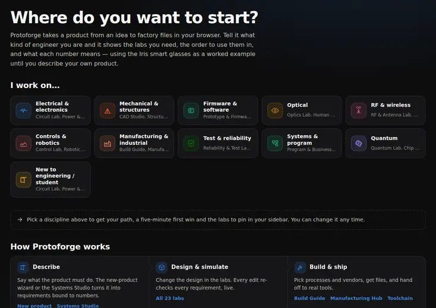</td></tr>
<tr><td>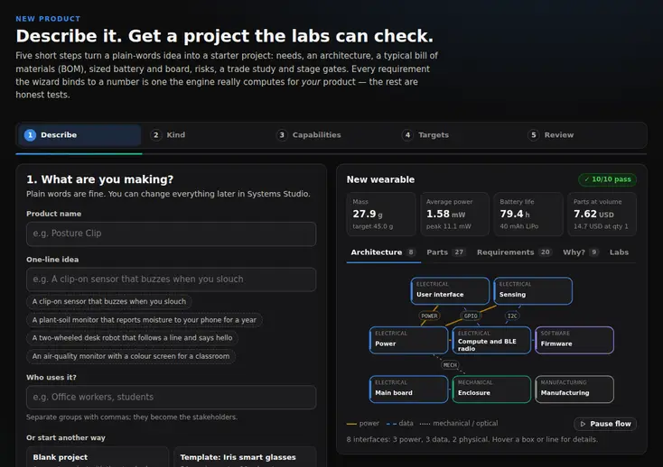</td><td>

**Describe your own product** — `#/new`

The new-product wizard: name it, pick one of ten kinds (wearable, handheld, IoT sensor, desk instrument, robot, low-voltage smart-home device, optical device, quantum testbed, dev board, mechanical part), toggle capabilities and drag targets. It generates needs, an architecture, a typical bill of materials, a battery sized from the power budget, risks, a trade study and stage gates. Requirements are bound **only** to metrics the engine computes from *your* product's data — verified live in the preview — and the *Why?* tab shows the arithmetic.

</td></tr>
<tr><td>

**What should I do next?** — Overview and Systems Studio

Every open issue — failing requirements, open goals, thin margins, unverified or untraced requirements, unmitigated risks, the next stage gate — ranked by a transparent score, with a *Go to Lab → Tab* link. Levers are **measured**: each candidate parameter is nudged 5 % and only the lab model behind the metric is re-run. **Try fixing this** solves one parameter for the target and re-verifies the whole product first — on Iris, a brighter display fixes outdoor contrast but breaks six power and thermal requirements.

</td><td>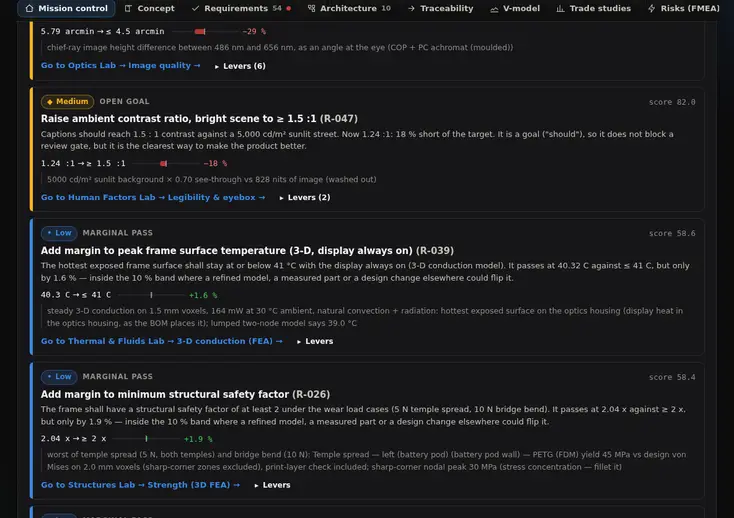</td></tr>
<tr><td>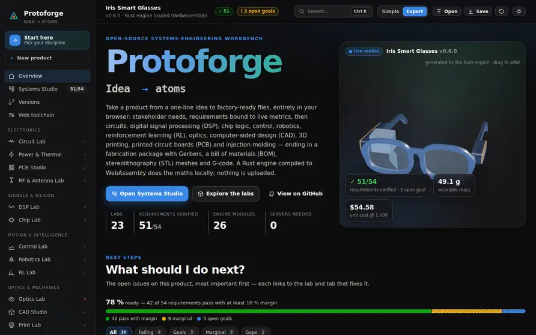</td><td>

**Jump anywhere, and get help in plain words**

Press **Ctrl K** (⌘ K) for the command palette: any lab, tab, requirement, metric, glossary term, guide or task. **Simple mode** pins your discipline's labs; **Expert mode** shows everything. Every lab has a **Help** panel: the question it answers, what you change, what you read (with good and bad ranges and live values), three steps to try, and an honest note on whether it analyses your product or the Iris example.

</td></tr>
</table>

<p align="center">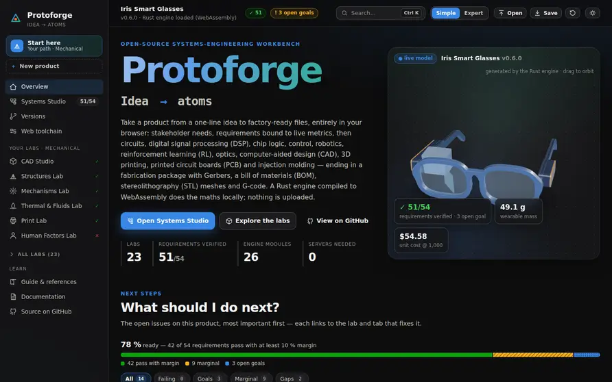<br/><sub>Simple mode, first visit to a lab: the help panel explains it in plain words, with live values.</sub></p>

---

## Contents

- [Easy for any engineer](#easy-for-any-engineer)
- [Build Iris step by step (animated walkthrough)](#build-iris-step-by-step)
- [The labs](#the-labs)
- [Real web tools, one click away](#real-web-tools-one-click-away)
- [Versions like Onshape](#versions-like-onshape)
- [Iris: the requirement table](#iris-the-requirement-table)
- [What the simulations caught](#what-the-simulations-caught)
- [Build anything: your own product](#build-anything-your-own-product)
- [Quick start](#quick-start) · [Command-line tool](#command-line-tool) · [REST server](#rest-server)
- [Architecture](#architecture)
- [Honest scope](#honest-scope-what-is-real-and-what-is-approximate)
- [Reference projects and further learning](#reference-projects-and-further-learning)
- [Repository layout](#repository-layout) · [Contributing](#contributing)

---

## Build Iris step by step

Every step below is a page of the live app. The clips are recorded from the real pages; open the app to drive them yourself.

<table>
<tr><td width="50%">

**1 · Define the product and verify it** — Systems Studio (`#/systems`)

Write the problem, the needs and the requirements; bind each requirement to a metric. Press *Run full verification* and watch every lab report in.

</td><td>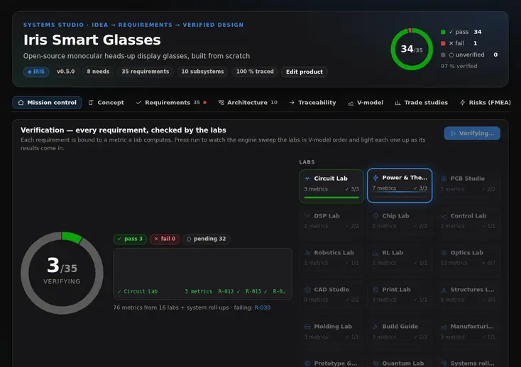</td></tr>
<tr><td>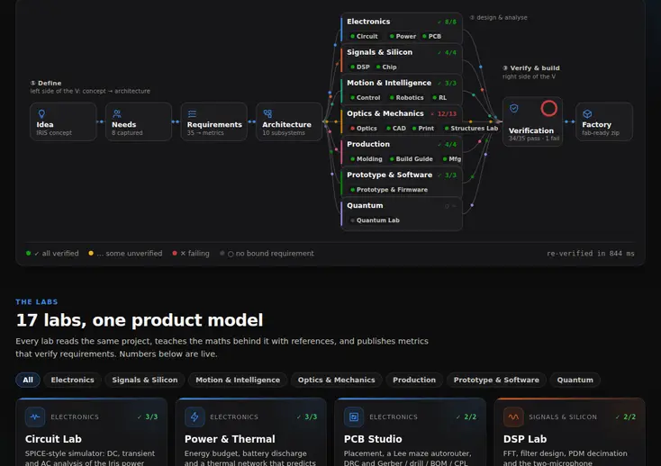</td><td>

**2 · See the whole pipeline** — Overview (`#/`)

The systems-engineering “V” as a live flow: each lab group shows how many of its requirements pass; click a node to open it.

</td></tr>
<tr><td>

**3 · Simulate the electronics** — Circuit Lab (`#/circuit`)

A simulator in the style of SPICE (Simulation Program with Integrated Circuit Emphasis), written in Rust. Presets for the Iris power rail, buck converter, battery sense, touch sensing and more, with current visibly flowing — or draw your own circuit in the **schematic editor**.

</td><td>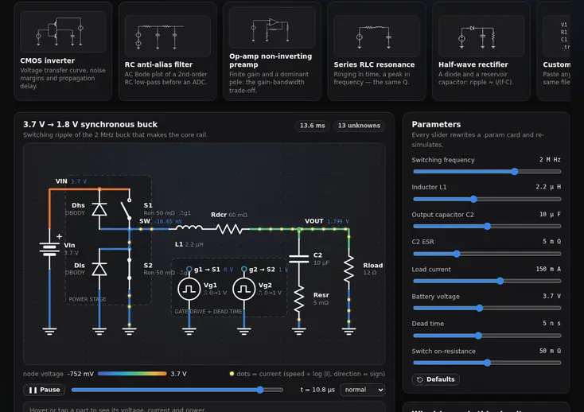</td></tr>
<tr><td>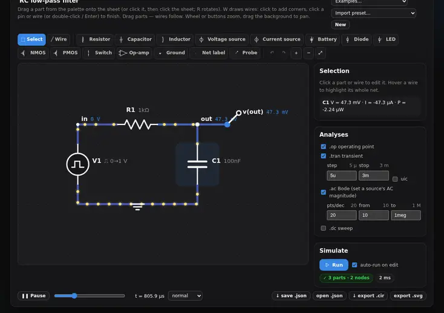</td><td>

**4 · Draw circuits like Falstad or EasyEDA** — Circuit Lab → Schematic editor

Place parts, wire them, and the engine turns the drawing into a netlist and simulates it live. Export the netlist for ngspice or open it in Falstad CircuitJS.

</td></tr>
<tr><td>

**5 · Budget power and heat** — Power & Thermal (`#/power`)

Duty-cycle energy budget from the bill of materials, battery discharge, and a thermal network that predicts the temperature against your skin.

</td><td>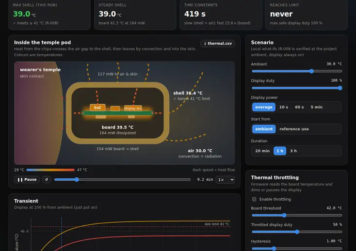</td></tr>
<tr><td>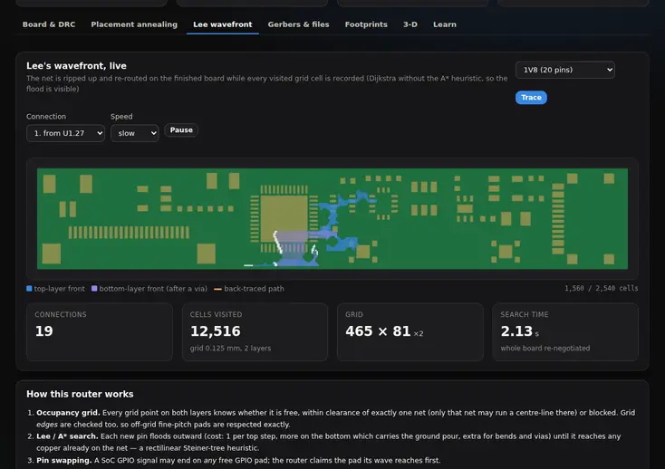</td><td>

**6 · Lay out and route the board** — PCB Studio (`#/pcb`)

Placement with simulated annealing, a Lee maze autorouter (watch the wavefront flood), design-rule check (DRC), and Gerber / drill / BOM / placement exports. The antenna feed is routed at its own controlled-impedance width.

</td></tr>
<tr><td>

**7 · Make the radio work on a head** — RF & Antenna Lab (`#/rf`)

A finite-difference time-domain (FDTD) field solver shows the 2.44 GHz wave soaking into a head phantom; antenna patterns, a Smith-chart matching designer, controlled-impedance traces and a Bluetooth Low Energy (BLE) link budget to a phone in a pocket.

</td><td>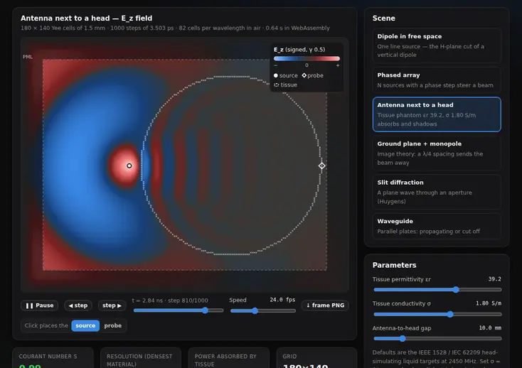</td></tr>
<tr><td>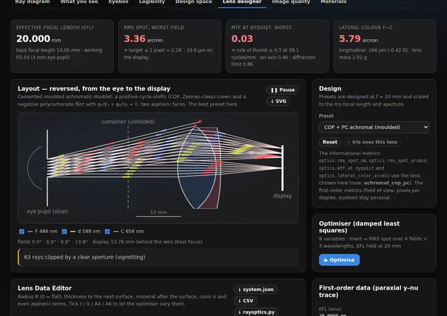</td><td>

**8 · Design the optics** — Optics Lab (`#/optics`)

Paraxial ray tracing of the display path, then **Optics Pro**: exact sequential ray tracing through real glasses and plastics, spot diagrams, modulation transfer function (MTF) and a damped-least-squares lens optimiser.

</td></tr>
<tr><td>

**9 · Model the frame** — CAD Studio (`#/cad`)

A parametric frame generated from eyewear sizes (lens width – bridge – temple length), with pods for the electronics and battery, mass properties and STL / OBJ / 3MF / STEP export.

</td><td>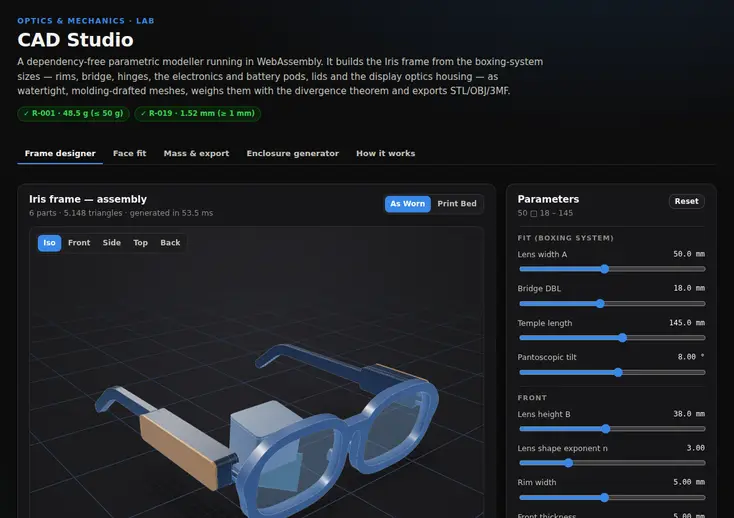</td></tr>
<tr><td>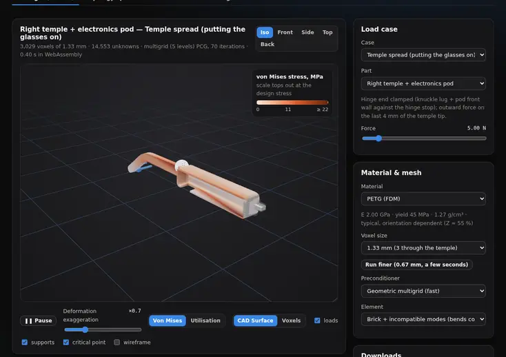</td><td>

**10 · Check it won't break** — Structures Lab (`#/structures`)

Voxel finite element analysis (FEA) of the real CAD parts under wear loads, animated deformation and von Mises stress, safety factors, fatigue life, Monte Carlo tolerance stack-ups — and topology optimisation that grows material only where it carries load.

</td></tr>
<tr><td>

**11 · Design the moving parts** — Mechanisms Lab (`#/mechanisms`)

Four-bar linkages, springs, gears and cams, animated with stress and life checks — and the Iris **spring hinge**: the temple opens over a detent, sits on the head, is pulled to its stop and folds, while the spring's Goodman fatigue factor updates.

</td><td>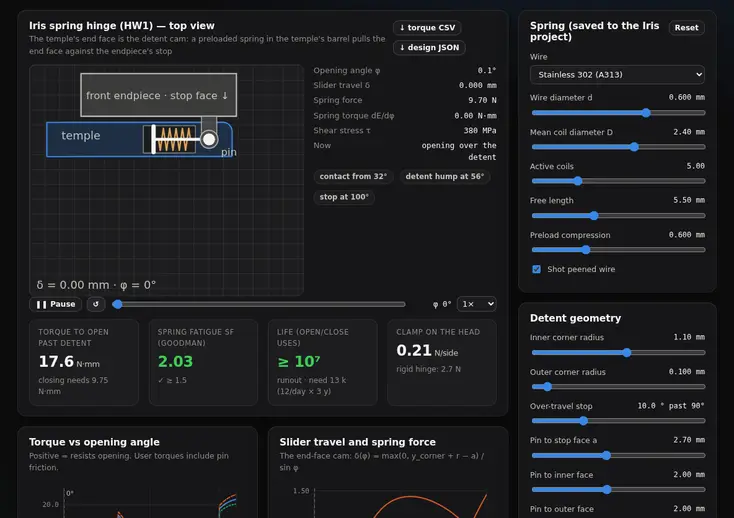</td></tr>
<tr><td>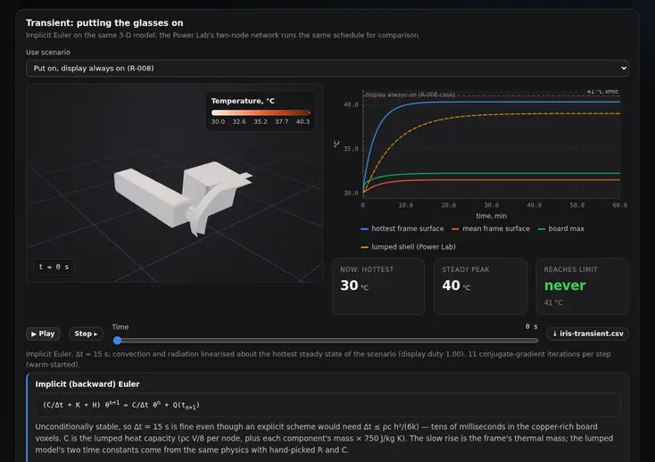</td><td>

**12 · Find the hot spot** — Thermal & Fluids Lab (`#/fluids`)

3-D heat-conduction finite elements on the real frame (natural convection and radiation), a transient "putting the glasses on" run next to the lumped model, heat-spreader trades, and a lattice-Boltzmann wind tunnel.

</td></tr>
<tr><td>

**13 · Fit real heads** — Human Factors Lab (`#/ergonomics`)

A parametric head wearing the CAD frame, Monte Carlo fit over thousands of simulated adults from published anthropometry, clamp force with the hinge in series, nose-pad pressure, eyebox coverage and display legibility in sunlight.

</td><td>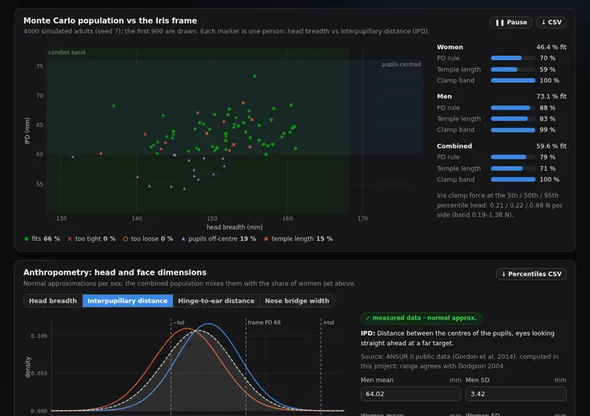</td></tr>
<tr><td>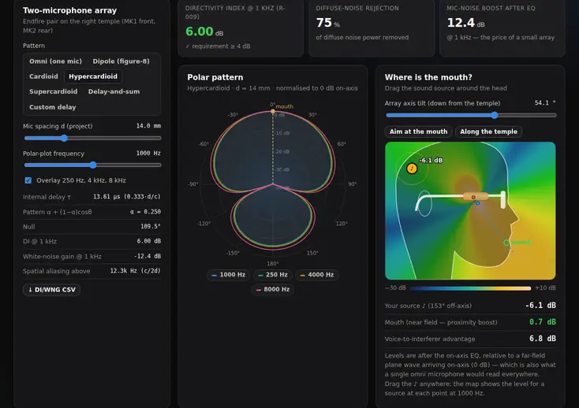</td><td>

**14 · Process the audio and design the chip** — DSP Lab & Chip Lab (`#/dsp`, `#/chip`)

The pulse-density-modulation (PDM) microphone chain, a two-microphone beamformer, logic minimisation, a touch-gesture state machine and a filter-to-Verilog generator with a Tiny Tapeout wrapper.

</td></tr>
<tr><td>

**15 · Track the head and learn a power policy** — Control, Robotics & RL Labs

Complementary and Kalman filters on a simulated inertial measurement unit (IMU), proportional–integral–derivative (PID) and linear–quadratic regulator (LQR) control, a SCARA robot that assembles the board, and reinforcement learning (RL) of a battery-saving policy.

</td><td>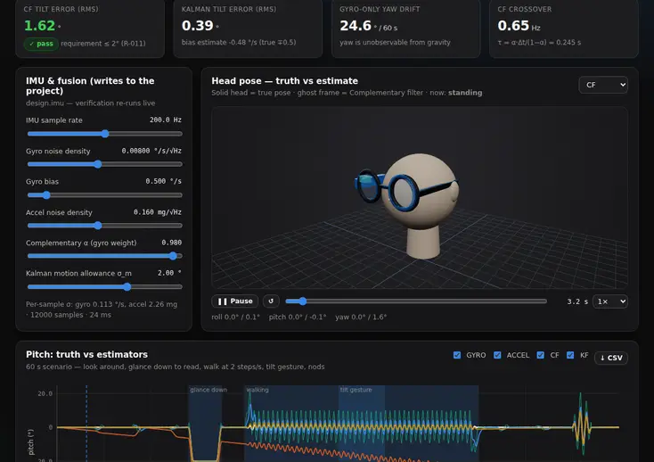</td></tr>
<tr><td>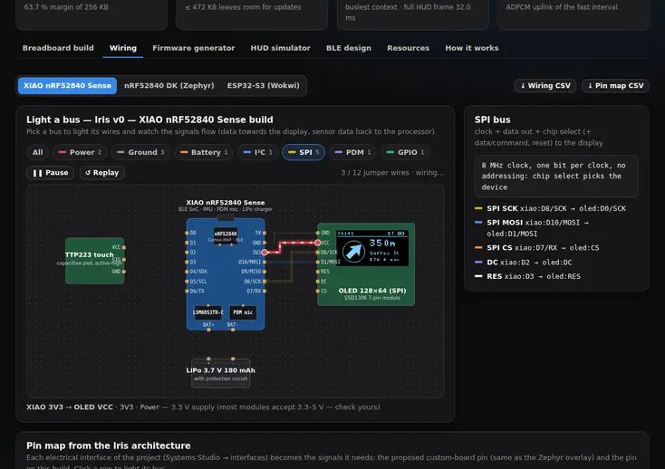</td><td>

**16 · Build a breadboard prototype** — Prototype & Firmware (`#/proto`)

Iris v0 from real development boards (Seeed XIAO nRF52840 Sense, nRF52840 DK, or an ESP32-S3 you can run in Wokwi): animated wiring by bus, a pin map, generated Zephyr / Arduino firmware and a pixel-exact heads-up-display simulator.

</td></tr>
<tr><td>

**17 · Print it** — Print Lab (`#/print`)

A planar slicer — perimeters, infill, skins, overhangs — with G-code, time and filament estimates and a layer-by-layer build-up.

</td><td>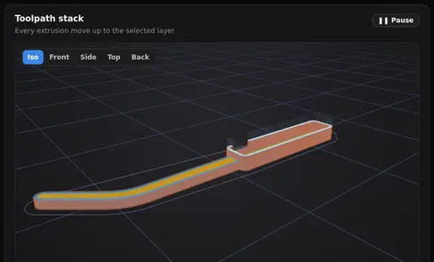</td></tr>
<tr><td>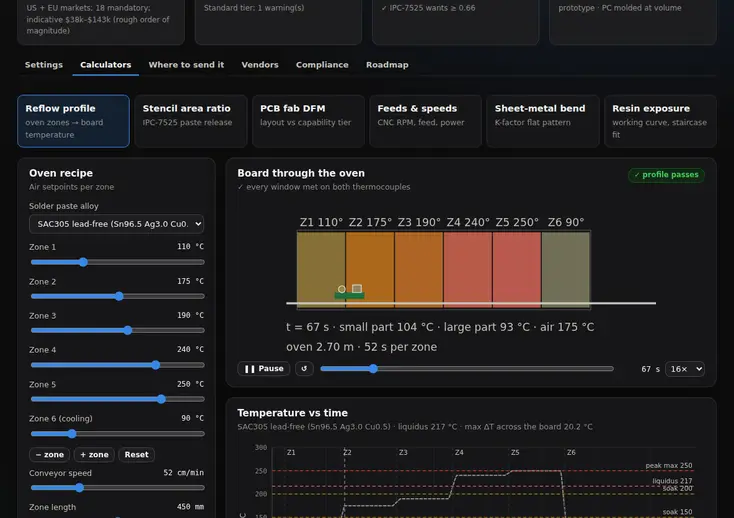</td><td>

**18 · Get the settings right and decide where to send it** — Build Guide, Molding Lab, Manufacturing Hub

Typical starting settings for printing, resin, laser, computer numerical control (CNC), sheet metal, stencils and reflow, each with a calculator and an animation; a process wizard, vendors by category, injection-molding design for manufacture (DFM), cost vs quantity and the compliance plan.

</td></tr>
<tr><td>

**19 · Prove it will last** — Reliability & Test Lab (`#/reliability`)

Weibull analysis built point by point, accelerated life tests, sample sizes for "R = 0.9 at 90 % confidence", a reliability block diagram of Iris, mean time between failures (MTBF) from parts counts, and a design-verification test (DVT) plan with a campaign Gantt chart.

</td><td>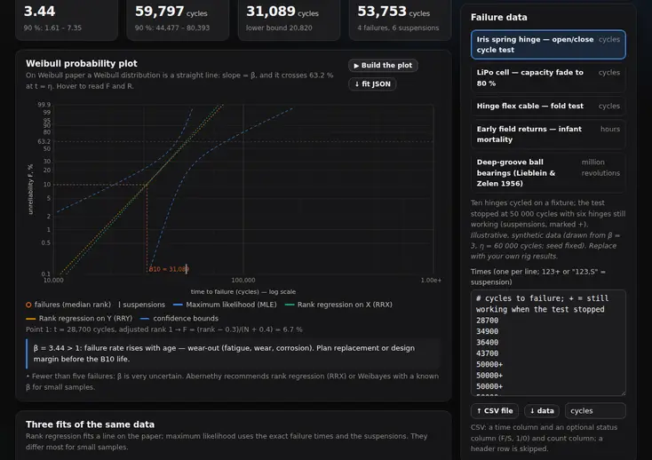</td></tr>
<tr><td>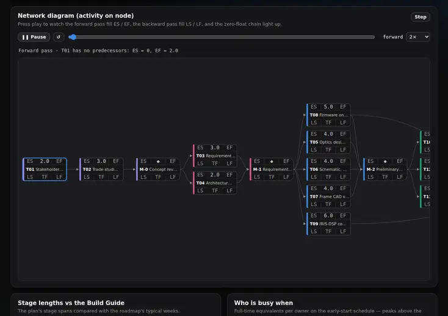</td><td>

**20 · Plan the program and the business** — Program & Business Lab (`#/program`)

A work breakdown, the critical path method (CPM) with animated forward and backward passes, Monte Carlo schedule risk, earned value, unit economics with net present value (NPV), and technology / manufacturing readiness levels (TRL / MRL) for the design reviews.

</td></tr>
<tr><td>

**21 · Version, branch and review** — Versions (`#/versions`)

Save named versions, branch to try ideas, merge by choosing, and compare any two versions to see exactly which requirement verdicts and margins moved.

</td><td>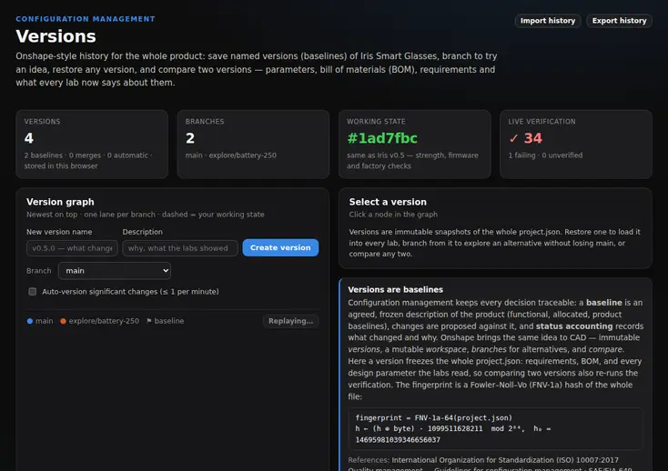</td></tr>
<tr><td>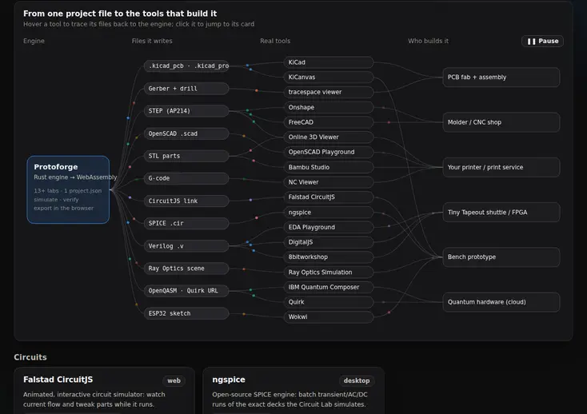</td><td>

**22 · Hand off to real tools and order** — Web toolchain (`#/toolchain`) and Manufacturing Hub (`#/mfg`)

Open the board in KiCad or KiCanvas, the frame in Onshape or the OpenSCAD playground, circuits in Falstad, quantum circuits in Quirk — then download the complete fabrication package.

</td></tr>
</table>

---

## The labs

Every lab reads the same product model, teaches the maths behind it with equations and references, publishes metrics that verify requirements, and offers downloads. Each has a guide in [`docs/labs/`](docs/labs), also readable inside the app at `#/docs`, and a plain-words **Help** panel in the app.

### Systems Studio — the front door


Mission control with **What should I do next?**, concept, requirements (with quality lint in the style of the International Council on Systems Engineering (INCOSE) guide), architecture with an N-squared (N²) interface matrix, traceability graph, animated V-model, trade studies with sensitivity tornadoes, Failure Mode and Effects Analysis (FMEA), mass/power/cost budgets, stage-gate roadmap, reports, the new-product wizard and templates (Iris, a wearable sensor tag, a desk robot, and **Q-Link**, a two-node fiber quantum key distribution testbed).

### Engineering labs

| Lab | What it does | Guide |
|---|---|---|
| **Circuit Lab** | SPICE-style simulator: modified nodal analysis (MNA), Newton–Raphson, trapezoidal transients, AC analysis; ten presets with animated schematics; drag-and-drop schematic editor | [circuit.md](docs/labs/circuit.md) |
| **Power & Thermal** | Energy budget, lithium-polymer discharge, two-node thermal network, throttling, battery trade | [power.md](docs/labs/power.md) |
| **PCB Studio** | Footprints, annealed placement, Lee maze router with net-class widths, DRC, Gerber X2 / Excellon / BOM / CPL | [pcb.md](docs/labs/pcb.md) |
| **RF & Antenna Lab** | FDTD fields with a head phantom, antenna patterns and arrays, Smith-chart L/π matching, microstrip and coplanar-waveguide impedance, BLE link budget and range map, Touchstone export | [rf.md](docs/labs/rf.md) |
| **DSP Lab** | Fast Fourier transform (FFT) and windows, FIR/IIR design, fixed point, PDM decimation chain, differential beamformer, audio playback | [dsp.md](docs/labs/dsp.md) |
| **Chip Lab** | Quine–McCluskey with Karnaugh maps, gate simulation with glitches, gesture state machine, FIR-to-Verilog, Tiny Tapeout export | [chip.md](docs/labs/chip.md) |
| **Control Lab** | Head-tracking sensor fusion, PID designer with Bode/root locus, LQR inverted pendulum | [control.md](docs/labs/control.md) |
| **Robotics Lab** | Arm kinematics, trajectories, SCARA pick-and-place of the Iris board, pure pursuit | [robotics.md](docs/labs/robotics.md) |
| **RL Lab** | Value iteration, Q-learning, CartPole, learned power policy | [rl.md](docs/labs/rl.md) |
| **Optics Lab** | Paraxial display optics, FOV/PPD/eyebox, **Optics Pro** sequential ray tracer, glass catalogue, spot diagrams, MTF, lens optimiser | [optics.md](docs/labs/optics.md) |
| **CAD Studio** | Parametric frame, face fit, mass properties, enclosure generator, STL/OBJ/3MF | [cad.md](docs/labs/cad.md) |
| **Print Lab** | Slicer, G-code, time/filament, overhangs | [print.md](docs/labs/print.md) |
| **Structures Lab** | Voxel 3D FEA, SIMP topology optimisation, snap fits, bolts, press fits, fatigue, modes, tolerance stack-ups | [structures.md](docs/labs/structures.md) |
| **Mechanisms Lab** | Four-bar linkages with coupler curves and transmission angle, helical/torsion springs with Goodman fatigue, involute gears with undercut, cams with SVAJ diagrams, the Iris spring hinge; DXF/SVG exports | [mechanisms.md](docs/labs/mechanisms.md) |
| **Thermal & Fluids Lab** | 3-D conduction FEA on the frame with convection and radiation, transients, spreader trades, convection correlations, lattice-Boltzmann wind tunnel, ParaView export | [fluids.md](docs/labs/fluids.md) |
| **Human Factors Lab** | Parametric head and anthropometry (ANSUR II), Monte Carlo fit coverage, S/M/L size search, clamp force, nose-pad load, eyebox coverage, legibility and contrast | [ergonomics.md](docs/labs/ergonomics.md) |
| **Molding Lab** | Draft and undercut maps, wall thickness, clamp force, cycle time, tooling cost | [molding.md](docs/labs/molding.md) |
| **Build Guide** | Process settings, CNC/laser/resin/sheet-metal/reflow/stencil calculators, process wizard, vendors, compliance planner, roadmap | [build.md](docs/labs/build.md) |
| **Manufacturing Hub** | Cost vs quantity, vendor directory, ordering guides, the fabrication package | [mfg.md](docs/labs/mfg.md) |
| **Reliability & Test Lab** | Weibull fitting (rank regression and maximum likelihood), bathtub curves, accelerated life tests, sample sizes, reliability block diagrams, parts-count MTBF, DVT plan and verification matrix | [reliability.md](docs/labs/reliability.md) |
| **Program & Business Lab** | Work breakdown, CPM and Gantt, Monte Carlo schedule risk, earned value, unit economics and cash flow, TRL/MRL readiness and design reviews | [program.md](docs/labs/program.md) |
| **Prototype & Firmware** | Breadboard builds, animated wiring, Zephyr/Arduino/Wokwi firmware generation, HUD simulator, BLE design, RAM/flash/CPU budgets | [proto.md](docs/labs/proto.md) |
| **Quantum Lab** | 14-qubit state-vector composer with Bloch spheres, algorithms, teleportation, CHSH, noise, BB84/E91 quantum key distribution with fiber link budgets, quantum random number generation with NIST SP 800-22 tests; OpenQASM 2/3, Qiskit and Quirk export | [quantum.md](docs/labs/quantum.md) |

<table>
<tr>
<td width="33%">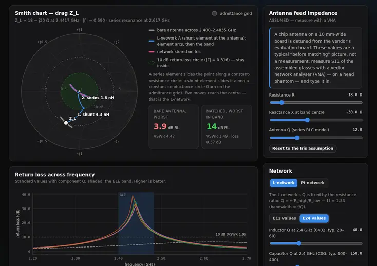<br/><sub>Dragging the antenna load on the Smith chart: the L-network and return loss follow</sub></td>
<td width="33%">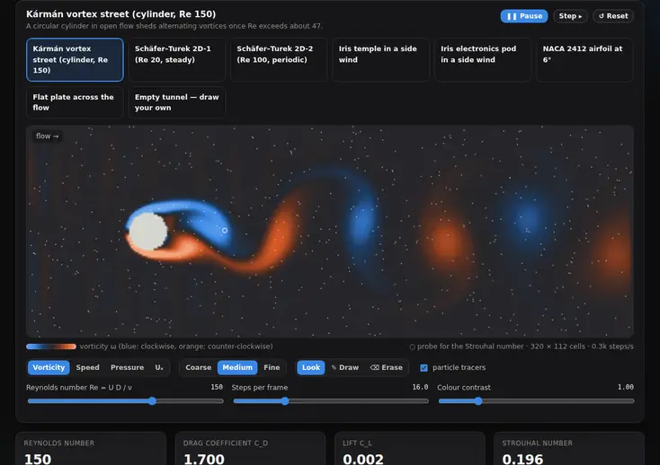<br/><sub>Lattice-Boltzmann wind tunnel: a Kármán vortex street at Reynolds number 150</sub></td>
<td width="33%">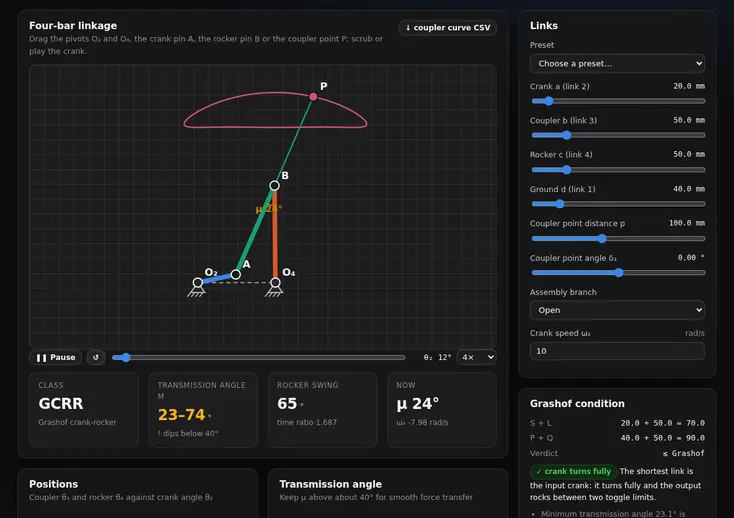<br/><sub>Hoeken straight-line four-bar tracing its coupler curve</sub></td>
</tr>
<tr>
<td>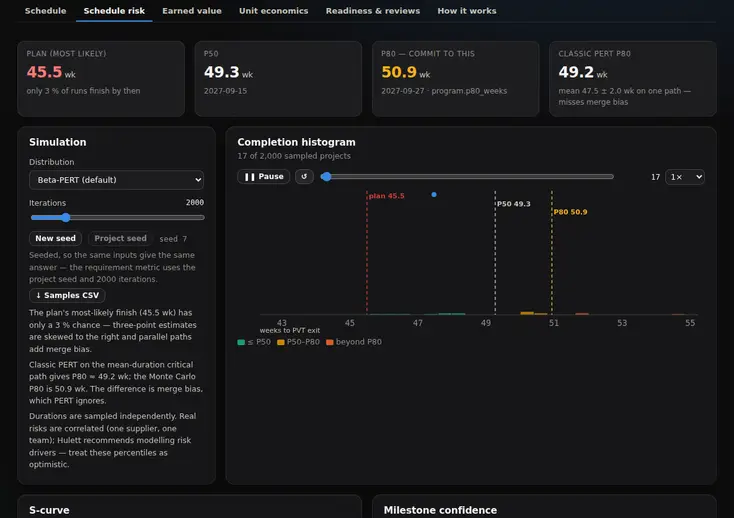<br/><sub>2,000 simulated schedules: P50 49.3 weeks, P80 50.9 weeks vs a 45.5-week plan</sub></td>
<td>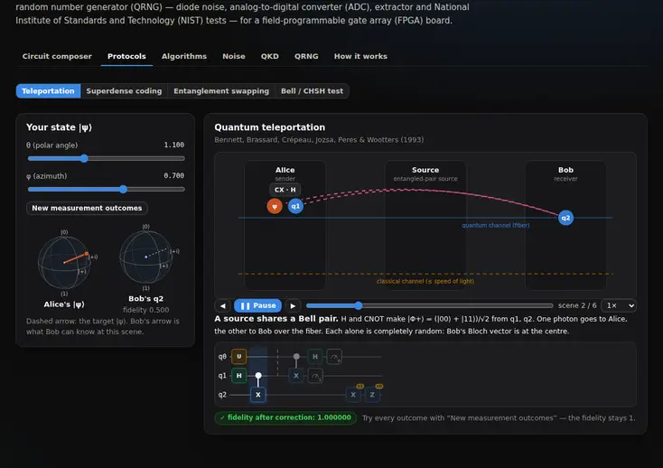<br/><sub>Quantum teleportation with classical feed-forward</sub></td>
<td>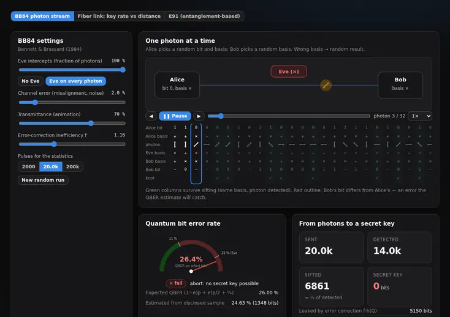<br/><sub>BB84: Eve on every photon drives the error rate to ~25 %</sub></td>
</tr>
<tr>
<td>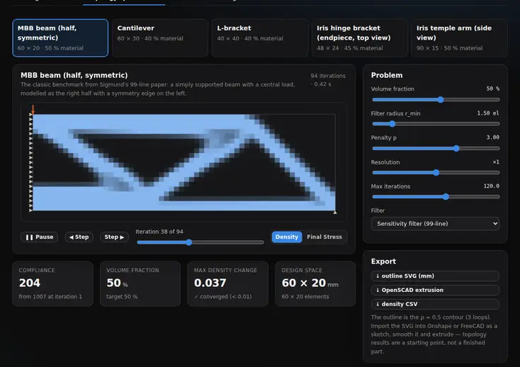<br/><sub>Topology optimisation (SIMP) growing a bracket</sub></td>
<td>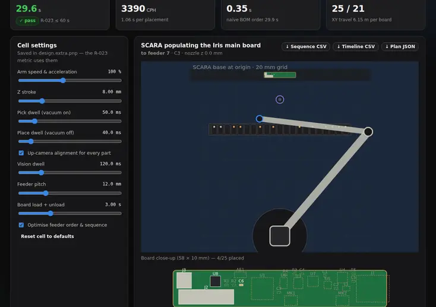<br/><sub>SCARA pick-and-place of the Iris board</sub></td>
<td>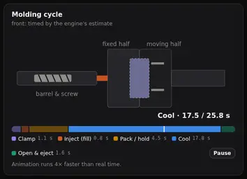<br/><sub>Injection-molding cycle: fill, pack, cool, eject</sub></td>
</tr>
<tr>
<td>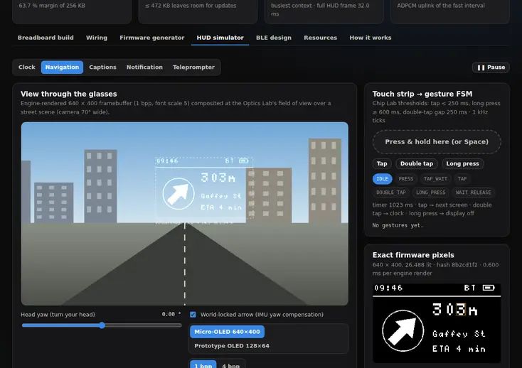<br/><sub>What the wearer sees, pixel-exact at 640 × 400</sub></td>
<td>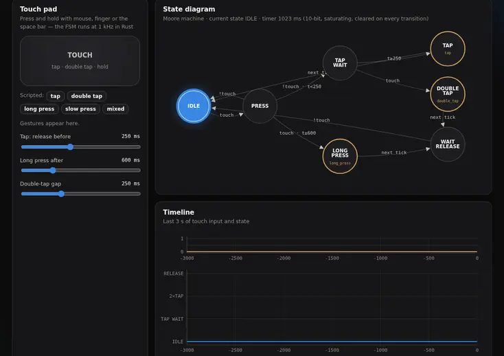<br/><sub>Touch-gesture state machine (double tap)</sub></td>
<td>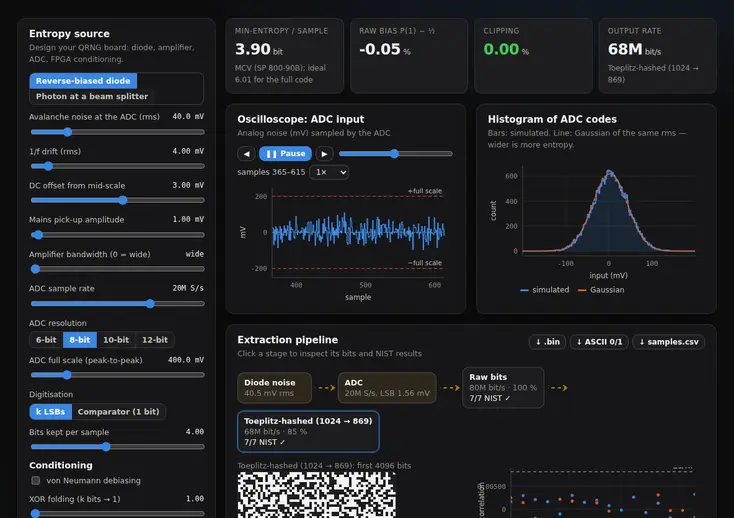<br/><sub>QRNG: diode noise → ADC → extractor → NIST tests</sub></td>
</tr>
</table>

### Light theme and phones

<p align="center">
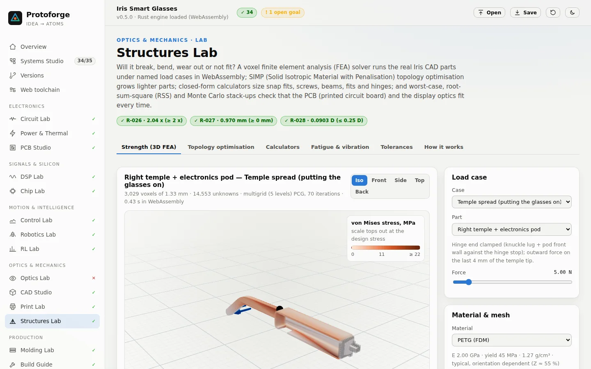
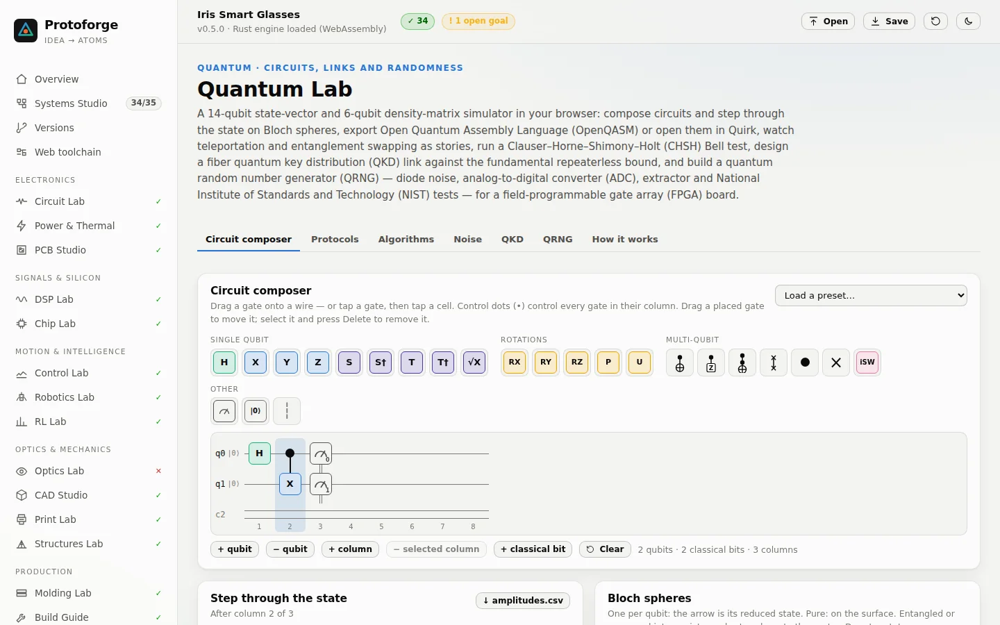
</p>
<p align="center"></p>

---

## Real web tools, one click away

Protoforge doesn't try to replace professional tools — it produces the files they need and sends you there. The **Web toolchain** page (`#/toolchain`) shows each hand-off with an animated how-to strip; every exporter is checked by an independent parser.

| Design artifact | Real tool | File we generate | Checked with |
|---|---|---|---|
| Circuit presets and schematics | [Falstad CircuitJS](https://www.falstad.com/circuit/) (web) | `circuitjs.html?ctz=…` link (lz-string) | reference lz-string decoder |
| Circuit netlists | ngspice (desktop, or the REST server's `/api/ngspice`) | `.cir` deck | ngspice syntax |
| Routed PCB | KiCad 7+, [KiCanvas](https://kicanvas.org) (web) | `.kicad_pcb`, `.kicad_pro`, netlist, `Protoforge.pretty` footprints | kiutils |
| Gerbers and drill | JLCPCB / PCBWay viewers, tracespace | Gerber X2, Excellon | gerbonara, pygerber |
| Antenna match | scikit-rf, any vector network analyser tool | Touchstone `.s1p` | scikit-rf |
| Frame | Onshape, FreeCAD, [3dviewer.net](https://3dviewer.net) | STEP (faceted B-rep), STL, OBJ, 3MF | gmsh (OpenCASCADE), trimesh |
| Parametric frame source | [OpenSCAD Playground](https://ochafik.com/openscad2) | `frame.scad` | OpenSCAD (WebAssembly build) |
| Temperature field | ParaView | VTK | the VTK format |
| Gears, cams | any CAD or laser cutter | DXF, SVG | — |
| Schedule | GanttProject, [Mermaid](https://mermaid.js.org) on GitHub | CSV, `gantt` diagram | — |
| Display optics | [Ray Optics Simulation](https://phydemo.app/ray-optics/) | scene JSON | the app's own schema |
| Quantum circuits | [Quirk](https://algassert.com/quirk), IBM Quantum Composer, Qiskit | Quirk link, OpenQASM 2/3, Python | round-trip tests |
| Breadboard firmware | [Wokwi](https://wokwi.com) | `diagram.json` + sketch | structure checks |
| Chip RTL | EDA Playground, Icarus Verilog, Yosys, Verilator | Verilog + testbench, Tiny Tapeout wrapper | simulated bit-exact vs the Rust model |

## Versions like Onshape

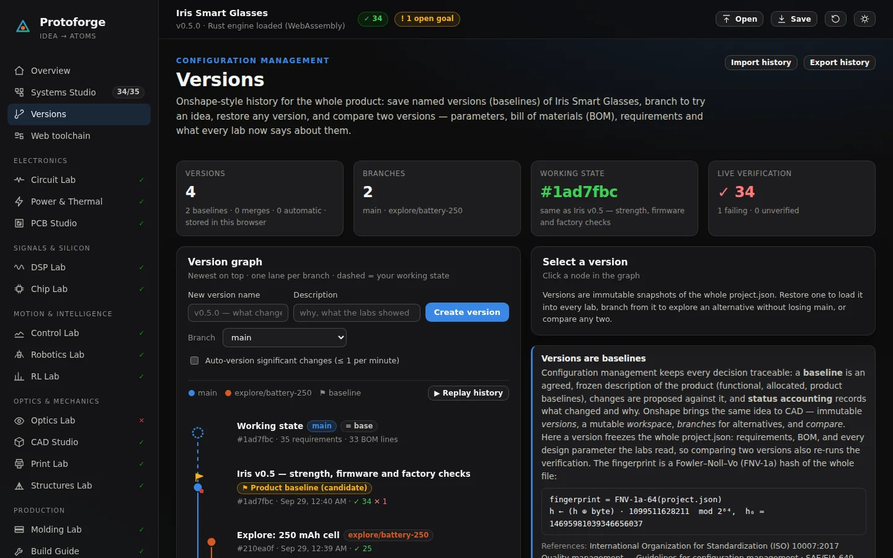

The **Versions** page (`#/versions`) keeps named versions of the whole product, branches for experiments, three-way merges where you choose “ours” or “theirs” for every difference, and baselines for configuration management. Comparing two versions is a design review: changed parameters, bill-of-materials lines, requirements, and — because both are re-verified — every requirement verdict and margin that moved. It ships with Iris's real history: v0.3 → v0.4 (simulation fixes) → v0.5 (strength, firmware and factory checks) → v0.6 (radio, heat, hinge, fit, reliability and program), plus a 250 mAh battery experiment branch.

---

## Iris: the requirement table

Iris is glasses with a 640 × 400 micro-OLED display in the right eye, two microphones, head tracking, a touch strip and a Bluetooth Low Energy link to a phone. Its whole definition lives in [`examples/smart-glasses/project.json`](examples/smart-glasses/project.json): 8 needs, 54 requirements, 10 subsystems, 10 interfaces, 42 bill-of-materials lines, 4 trade studies, 8 FMEA risks and 6 milestones.

`protoforge evaluate` today (v0.6):

| ID | Requirement | Value | Target | Verified by |
|---|---|---|---|---|
| R-001 | Total wearable mass | 49.1 g | ≤ 50 g | CAD Studio + BOM |
| R-002 | Battery life, mixed use | 13.8 h | ≥ 8 h | Power & Thermal |
| R-003 | Average system power | 54.8 mW | ≤ 80 mW | Power & Thermal |
| R-004 | Horizontal field of view (FOV) | 23.6° | ≥ 20° | Optics Lab |
| R-005 | Angular resolution | 27.2 px/° | ≥ 25 px/° | Optics Lab |
| R-006 | Virtual image distance | 1.34 m | 1–3 m | Optics Lab |
| R-007 | Eyebox width | 6.0 mm | ≥ 5 mm | Optics Lab |
| R-008 | Skin temperature, display always on, 30 °C (lumped model) | 39.0 °C | ≤ 41 °C | Power & Thermal |
| R-009 | Microphone directivity index at 1 kHz | 6.0 dB | ≥ 4 dB | DSP Lab |
| R-010 | Decimation-filter stopband attenuation | 67.6 dB | ≥ 60 dB | DSP Lab |
| R-011 | Head-orientation error | 1.62° RMS | ≤ 2° | Control Lab |
| R-012 | 1.8 V rail droop on display turn-on | 7.5 mV | ≤ 50 mV | Circuit Lab |
| R-013 | Buck converter ripple | 1.5 mV | ≤ 30 mV | Circuit Lab |
| R-014 | Battery-sense divider current | 1.68 µA | ≤ 2 µA | Circuit Lab |
| R-015 | Co-processor critical path at 50 MHz | 15.3 ns | ≤ 20 ns | Chip Lab |
| R-016 | Co-processor standard-cell count | 2044 | ≤ 3000 | Chip Lab |
| R-017 | PCB nets routed | 100 % | 100 % | PCB Studio |
| R-018 | Design-rule violations | 0 | 0 | PCB Studio |
| R-019 | PCB fits the pod (nominal) | 1.5 mm | ≥ 1 mm | CAD + PCB |
| R-020 | Molding draft on side walls | 1.5° | ≥ 1° | Molding Lab |
| R-021 | Prototype frame print time | 1.8 h | ≤ 8 h | Print Lab |
| R-022 | Unit cost at 1,000 units | $54.58 (indicative) | ≤ $120 | Manufacturing Hub |
| R-023 | Pick-and-place cycle per board | 38.1 s | ≤ 60 s | Robotics Lab |
| R-024 | Learned power policy battery gain (goal) | +24.8 % | ≥ 5 % | RL Lab |
| R-025 | Combiner clears the collimating lens | 0.78 mm | ≥ 0 mm | Optics Lab |
| R-026 | Frame structural safety factor (2 mm verification mesh) | 2.04 | ≥ 2 | Structures Lab |
| R-027 | PCB fits the pod, worst-case tolerance stack | 0.97 mm | ≥ 0 mm | Structures Lab |
| R-028 | Display focus error over tolerances | 0.09 D | ≤ 0.25 D | Structures Lab |
| R-029 | Collimator RMS spot size | 19.4 µm | ≤ 26 µm | Optics Pro |
| R-030 | Lateral colour (goal) | **5.8′ — open** | ≤ 4.5′ | Optics Pro |
| R-031 | Firmware RAM margin | 63.7 % | ≥ 25 % | Prototype & Firmware |
| R-032 | Firmware flash margin | 56.4 % | ≥ 20 % | Prototype & Firmware |
| R-033 | Glasses-side caption latency | 52.8 ms | ≤ 100 ms | Prototype & Firmware |
| R-034 | PCB fab capability violations (standard tier) | 0 | 0 | Build Guide |
| R-035 | Stencil area ratio (IPC-7525) | 0.80 | ≥ 0.66 | Build Guide |
| R-036 | Antenna return loss across 2.400–2.4835 GHz | 14.1 dB | ≥ 10 dB | RF & Antenna |
| R-037 | Antenna feed impedance, as routed | 49.9 Ω | 45–55 Ω | RF & Antenna + PCB |
| R-038 | BLE link margin to a phone 5 m away, worn | 8.9 dB | ≥ 0 dB | RF & Antenna |
| R-039 | Hottest exposed frame surface (3-D model) | 40.3 °C | ≤ 41 °C | Thermal & Fluids |
| R-040 | Hot spot above the mean surface temperature | 8.9 °C | ≤ 10 °C | Thermal & Fluids |
| R-041 | Hinge spring Goodman fatigue safety factor | 2.03 | ≥ 1.5 | Mechanisms |
| R-042 | Hinge spring life (12 uses a day, 3 years) | 10⁷ (run-out) | ≥ 13,140 | Mechanisms |
| R-043 | Torque to open past the detent | 17.6 N·mm | 3–30 N·mm | Mechanisms |
| R-044 | One frame size fits adults (50 % women) | 59.7 % | ≥ 30 % | Human Factors |
| R-045 | Nose-pad contact pressure | 3.83 kPa | ≤ 4.3 kPa | Human Factors |
| R-046 | Wearers who see the whole image | 89.6 % | ≥ 85 % | Human Factors |
| R-047 | Caption contrast on a sunlit street (goal) | **1.24 : 1 — open** | ≥ 1.5 : 1 | Human Factors |
| R-048 | 2-year reliability (battery wear-out counts) | 90.4 % | ≥ 90 % | Reliability & Test |
| R-049 | Parts-count MTBF of the electronics | 3.37 million h | ≥ 1 million h | Reliability & Test |
| R-050 | DVT units for R = 0.9 at 90 % confidence | 37 | ≤ 40 | Reliability & Test |
| R-051 | Production-validation exit at 80 % confidence | 50.9 weeks | ≤ 52 weeks | Program & Business |
| R-052 | Gross margin at the retail price | 60.7 % | ≥ 50 % | Program & Business |
| R-053 | Every subsystem at TRL 6 by critical design review (goal) | **TRL 3 — open** | ≥ 6 | Program & Business |
| R-054 | See-through transmission of the combiner | 70 % | ≥ 60 % | Optics Lab |

Requirements of kind *goal* are “should” targets: an open goal is reported in amber in the app but does not fail continuous integration; a binding requirement does. `protoforge next` ranks them: **42 of 54 pass with at least 10 % margin; 9 pass narrowly** — R-039, R-026 and R-048 among them — which is where the next prototype's tests should look first.

## What the simulations caught

The point of binding requirements to simulations is that the numbers argue back. Each fix below is recorded in the seeded version history, so you can compare the versions yourself in `#/versions`.

**v0.3 → v0.4**
- **An over-voltage on an input pin.** The Circuit Lab showed the original 1 MΩ / 1.2 MΩ battery-sense divider puts 2.29 V on the 1.8 V system-on-chip's analog input at a full cell. The divider became 1.5 MΩ / 1 MΩ (1.68 V).
- **Optics that could not be assembled.** The Optics Lab ray trace showed an 18 mm lens 8 mm from a 45° combiner makes the parts intersect. The layout moved to 11 mm and requirement R-025 now guards it.
- **A chip architecture that could not close timing.** A transposed-form FIR needed 57 ns and 3,586 cells; the decimating multiply-accumulate design meets 15 ns and 2,044 cells.

**v0.4 → v0.5**
- **An out-of-focus display.** The Structures Lab's tolerance stack showed a printed optics housing alone gives ±0.60 dioptres of focus error against ±0.25 D. v0.5 adds a fine-thread focus cell set at assembly (0.09 D) and requirement R-028.
- **A stencil with no margin.** The Build Guide's IPC-7525 check found the 0.12 mm stencil's worst area ratio at 0.667 on the QFN pads — right on the 0.66 limit. v0.5 moves to 0.10 mm (0.80).

**v0.5 → v0.6** — six new labs added eighteen requirements, and v0.5 failed nine binding ones:
- **A radio with no matching network.** Return loss was 3.9 dB (most of the power reflected) and the feed trace was a ~100 Ω line. v0.6 adds a series 1.8 nH + shunt 4.3 nH match (14.1 dB) and routes the feed as a 0.91 mm grounded coplanar waveguide (49.9 Ω) — R-037 reads the routed board, not the intention.
- **A 63 °C optics housing.** The lumped thermal model said the pod was fine; the 3-D model found the heat sitting in the optics housing. A 25 µm graphite sheet brings the hottest surface to 40.3 °C.
- **A hinge spring that would fatigue, and glasses that fit nobody.** The spring's Goodman factor was 1.40; a shot-peened, stiffer spring with a 10° stop gives 2.03. Coupling the Mechanisms hinge into the Human Factors clamp model showed one frame size fitting 0 % of adults; it now fits 60 %. Nose pads went from 19 kPa to 3.8 kPa, and eyebox coverage from 60 % to 90 %.
- **A battery that wore out.** Counting a cell below 80 % capacity as a failure, 2-year reliability was 76 %. A 240 mAh cell gives 90 %, its extra 1.3 g paid for with a 4.5 mm rim; trade study T-3 is now scored from the lab metrics and picks the same cell.
- **The board finally carries what it needs.** The crystal, the matching network and the USB-C configuration-channel resistors PCB Studio had flagged since v0.3 are on the board, still routed 100 % with zero DRC violations.

**Round 4 — the assistant argues back too.** The new solver showed that raising the combiner's reflectance fixes outdoor contrast (R-047) "for free" — by silently dropping see-through to 51 %. **R-054 (see-through ≥ 60 %)** now guards it, so both levers for R-047 break something: a brighter display costs six power and thermal requirements, a more reflective combiner costs the view of the street. That is the honest reason R-047 stays an open goal until a tinted lens or a new display arrives.

---

## Build anything: your own product

Iris is just the first project.

1. **Start here** (`#/start`) — pick your discipline for a guided path, or go straight to:
2. **New product** (`#/new`) — the wizard turns a kind, capabilities and targets into a starter project with its battery sized, its board estimated and its requirements bound to metrics computed from your own bill of materials. Or start from a template (Iris, Pebble sensor tag, Pip desk robot, Q-Link quantum link), or blank. From a terminal: `protoforge new "Clip" --kind wearable --with ble,battery --life 24h > clip.json`.
3. **Requirements bound to metrics** — the requirement form lists every metric the engine produces (107 for Iris) with its current value.
4. **Design in the labs** — every lab's Help panel says whether it analyses your product or the Iris example, and a note in the lab header repeats it when your own product is loaded.
5. **Follow "What should I do next?"** — fix what it ranks first; use *Try fixing this* to solve for a target and see the side effects before applying.
6. **Version it**, **iterate until green**, then **build**: breadboard prototype, process settings, vendors, test plan, compliance plan, fabrication package — and graduate to the professional tools in the toolchain.

The whole product is one JSON document ([schema in `project.rs`](crates/forge-core/src/project.rs)); save it with **Save**, keep it in Git, open it again with **Open**.

---

## Quick start

**Use it:** open the [live app](https://normansrule.github.io/protoforge/). Nothing to install.

**Run it locally** (Ubuntu or Windows Subsystem for Linux (WSL2); details in [docs/getting-started.md](docs/getting-started.md)):

```bash
# prerequisites: Rust (rustup), Node 22
rustup target add wasm32-unknown-unknown
cargo install --locked wasm-bindgen-cli --version 0.2.129

git clone git@github.com:Normansrule/protoforge.git
cd protoforge
./scripts/build-wasm.sh            # Rust engine -> web/src/wasm
cd web && npm ci && npm run dev    # http://localhost:5173
```

**Checks:**

```bash
cargo test --workspace             # 720+ tests
cargo clippy --workspace --all-targets -- -D warnings
(cd web && npm run build)          # TypeScript strict + production build
```

**Deploy your own copy:** push to GitHub, then *Settings → Pages → Source: GitHub Actions*. [`pages.yml`](.github/workflows/pages.yml) builds the engine and the site on every push to `main`.

## Command-line tool

```text
protoforge evaluate [project.json]              verify every requirement (exit 1 if a binding one fails)
protoforge next     [project.json] [--all]      what to do next: ranked actions with measured levers
protoforge metrics  [project.json]              every metric the labs compute, with notes
protoforge report   [project.json]              Markdown verification report
protoforge package  [project.json] [--out DIR]  write the full fabrication package
protoforge lint     [project.json]              structural and requirement-quality checks
protoforge new "<name>" --kind <kind> --with ble,display,battery --life 12h
                                                starter project from the new-product wizard
protoforge wizard [@answers.json] | --options   wizard answers → project.json; list kinds and capabilities
protoforge call <method> [json | @file.json]    call any of the 302 engine methods
protoforge methods                              list engine modules
```

```text
$ protoforge next
Iris Smart Glasses v0.6.0 — what to do next
78 % ready: 42 of 54 requirements pass with ≥ 10 % margin · 9 marginal · 3 open goal(s) · 0 failing · 0 unverified

 3. [MEDIUM] goal · score 82.0
    Raise ambient contrast ratio, bright scene to ≥ 1.5 :1 (R-047)
    now 1.24 :1 → ≥ 1.5 :1 (margin -17.6 %)
    go to: Human Factors Lab → Legibility & eyebox  (#/ergonomics?tab=display)
    ↑ Optics · combiner reflectance: +0.015  moves it +0.0173 :1 · ≈ 0.555  reaches the target
    ↑ Optics · display luminance: +150 cd/m² moves it +0.0118 :1 · ≈ 6721 cd/m² reaches the target
```

`protoforge package` writes 98 files for Iris:

```text
out/iris/
├── README.md                    index of everything below
├── pcb/                         Gerber X2 layers, Excellon drill, BOM.csv, CPL.csv, fab notes
├── kicad/                       .kicad_pcb, .kicad_pro, netlist, fp-lib-table, Protoforge.pretty/ footprints
├── cad/                         STL per part, assembly.obj, STEP (as worn and print orientation), frame.scad
├── print/                       G-code per part
├── firmware/                    Zephyr project (nRF52840) and Arduino sketch (XIAO breadboard)
├── molding/                     injection-molding DFM report
├── compliance/                  compliance plan (commonly applicable standards — confirm with a test lab)
├── cost/                        cost vs quantity (CSV + report)
├── guides/                      how to order: PCB assembly, 3D printing, injection molding
├── verification-report.md       every requirement with its value and source
└── project.json
```

Continuous integration runs `protoforge evaluate` on every push and attaches the fabrication package to every run.

## REST server

`cargo run --release -p forge-server -- --port 8787 --static web/dist` serves the app and every engine method over HTTP:

```bash
curl localhost:8787/api/health
curl -X POST localhost:8787/api/systems.next_actions -d "{\"project\": $(cat examples/smart-glasses/project.json)}"
curl -X POST localhost:8787/api/package --data-binary @examples/smart-glasses/project.json -o iris-fab.zip
curl -X POST localhost:8787/api/ngspice -d '{"netlist":"..."}'   # cross-check a deck in ngspice if installed
```

See [`crates/forge-server/README.md`](crates/forge-server/README.md).

---

## Architecture

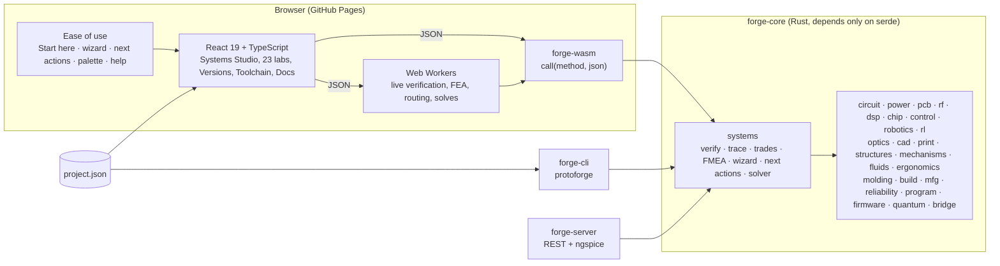

- **One JSON method API** — 302 methods across 26 modules, the same from the browser (`call("structures.fea", {...})`), over HTTP (`POST /api/structures.fea`) and from the CLI. The catalogue is generated from the source at build time (`api.catalog`).
- **Metrics bind to requirements** — each module exposes `metrics(project)`; `systems.evaluate` collects 107 metrics for Iris and checks every criterion. Expensive analyses (FEA, routing, molding, 3-D heat) are memoised on exactly the inputs they read, and the browser runs verification in a Web Worker so the page never blocks.
- **Guidance is computed, not scripted** — `systems.next_actions` ranks issues by a stated rule, `systems.next_levers` measures each lever by finite differences on the owning lab's model, and `systems.solve_lever` solves one parameter for a target and re-verifies everything.
- **Dependency-free engine** — about 126,000 lines of Rust with its own linear algebra, sparse solvers, FFT, mesh kernel, slicer, router, circuit simulator, finite elements, FDTD and lattice-Boltzmann solvers and quantum simulator, compiled to one WebAssembly module. The front end is about 58,000 lines of TypeScript.
- **Deterministic** — all randomness is seeded. Native builds and WebAssembly use different floating-point maths libraries, so a few geometry-derived numbers can differ in the last digits between the browser and the CLI; no verdict changes.

Details: [docs/architecture.md](docs/architecture.md). Adding a lab: [docs/CONTRIBUTING-LABS.md](docs/CONTRIBUTING-LABS.md).

---

## Honest scope: what is real and what is approximate

Protoforge is built to teach and to get a design to a credible first prototype quickly. It says so wherever it matters.

| Area | Real | Approximate — graduate to |
|---|---|---|
| Circuits | MNA, Newton–Raphson, trapezoidal transients, AC; matches hand calculations in tests | Level-1 MOSFETs, dense matrices, no subcircuits → **ngspice**, Xyce, KiCad's simulator |
| PCB | Placement, maze routing with net-class widths, DRC, valid Gerber X2 / Excellon / KiCad files | Grid routing only; illustrative pinout; approximate land patterns → **KiCad** + FreeRouting |
| RF | 2-D FDTD with a perfectly matched layer, exact L/π-network synthesis, closed-form line impedances, Friis and log-distance link budgets | The chip-antenna impedance is an **assumption** until measured with a vector network analyser; 2-D fields, no full-wave 3-D → **openEMS**, scikit-rf, a VNA |
| Chips | Verilog simulated bit-exact against the Rust model | Cell counts and timing from a first-order model → **Yosys**, **OpenLane 2 / OpenROAD**, Tiny Tapeout |
| Structures | Voxel hexahedral FEA, SIMP, textbook calculators, Monte Carlo stacks | Linear, isotropic, no contact; voxel stair-stepping — R-026 uses a coarse 2 mm mesh and finer meshes read lower (≈1.5), so treat it as marginal until a tetrahedral model or a physical test confirms it; the drop-test factor is an upper bound on force → **CalculiX**, FreeCAD FEM, Code_Aster |
| Mechanisms | Exact planar kinematics, Shigley spring and gear equations, Goodman/Zimmerli fatigue | Rigid links, no inertia or clearances; fatigue scatters 3–10× in life → SolveSpace, physical cycle tests |
| Thermal & fluids | 3-D steady and transient conduction with convection and radiation coefficients; D2Q9 lattice-Boltzmann | Coefficients from correlations, not computational fluid dynamics around the head; the lumped R-008 model and the 3-D model disagree on the pod (39 vs 31 °C) and both are shown → **Elmer**, OpenFOAM, a thermocouple |
| Human factors | Published anthropometry (ANSUR II), Monte Carlo coverage, lever-rule loads | Normal approximations for some dimensions; comfort limits are typical values from the literature → fit trials with real people |
| Optics | Exact sequential ray tracing, spot diagrams, geometric MTF | Rotationally symmetric surfaces, no tolerancing or stray light → rayoptics, Zemax OpticStudio |
| CAD | Exact volumes, drafted walls, faceted STEP | Mesh modeller, not exact solids; some parts are several closed shells touching face to face → **Onshape**, FreeCAD, build123d, CadQuery |
| Printing | Working slicer and G-code | Rectilinear infill, no supports → **Bambu Studio**, OrcaSlicer, PrusaSlicer |
| Firmware | Generated Zephyr/Arduino projects, resource budgets | Starting points — compile and test on hardware; stack sizes are stated assumptions |
| Reliability | Weibull fitting, exact binomial sample sizes, block diagrams | Parts-count failure rates are **typical** values → supplier failure-rate data, physical life tests |
| Program & business | Exact CPM, seeded Monte Carlo, standard earned-value formulas | Durations, prices and costs are labelled assumptions; TRL/MRL are suggested from evidence, not certified → your own plan and quotes |
| Wizard & next actions | Requirements bound only to metrics that respond to your data (tested); levers measured by finite differences | Typical part classes, not quotes; one-parameter solves; curated lever lists per lab |
| Quantum | Exact state-vector and density-matrix simulation; asymptotic decoy-state key rates | No finite-key effects or device side channels → Qiskit, QuTiP, published QKD security proofs |
| Build, cost, compliance | Transparent formulas with editable assumptions | **Typical starting settings; indicative costs; commonly applicable standards — get real quotes and confirm with an accredited test lab** |

---

## Reference projects and further learning

- **[docs/reference-repos.md](docs/reference-repos.md)** — mature open-source projects to study and to cross-check each lab (ngspice, KiCad, FreeRouting, scikit-rf, openEMS, Yosys, OpenROAD, Tiny Tapeout, SciPy, python-control, MuJoCo, Gymnasium, CadQuery, build123d, FreeCAD, SolveSpace, OrcaSlicer, ray-optics, CalculiX, Gmsh, Elmer, Qiskit, Quirk, QuTiP, Zephyr, nRF Connect SDK, Wokwi, KiCanvas, GanttProject, Brilliant Labs' open glasses, OpenGlass …).
- **[docs/references.md](docs/references.md)** — the consolidated bibliography, from Nagel's SPICE2 thesis, Yee's FDTD paper and Zienkiewicz's finite element method to Shigley's mechanical design, the ANSUR II survey, Abernethy's Weibull handbook, Bennett & Brassard's BB84, NIST SP 800-22, IPC-7525 and the NASA Systems Engineering Handbook. Every lab page cites its sources inline.
- **In the app:** *Start here* (`#/start`) for a path by discipline; *Guide & references* (`#/learn`) with a workflow guide, a searchable glossary and free English learning resources; *Documentation* (`#/docs`) renders every guide in this repository; **Ctrl K** finds any of it.

## Repository layout

```text
protoforge/
├── crates/
│   ├── forge-core/        the engine: 26 modules, one per discipline (~126k lines of Rust, 700+ tests)
│   ├── forge-wasm/        WebAssembly bridge: call(method, json)
│   ├── forge-cli/         `protoforge` command-line tool
│   └── forge-server/      axum REST server (+ ngspice cross-check)
├── web/                   React 19 + TypeScript + Vite app (~58k lines)
│   └── src/
│       ├── ux/            Start here, wizard, next actions, command palette, lab help, navigation
│       ├── pages/         Overview, Systems Studio, Versions, Web toolchain, Docs, Guide
│       ├── labs/          one folder per lab (23)
│       ├── components/    Plot, Scene3D, UI primitives, error boundary
│       ├── engine/        WebAssembly loader, hooks, Web Worker client
│       └── state/         project store + shared live verification
├── examples/smart-glasses/project.json    the Iris product definition
├── docs/                  start here, architecture, lab guides, toolchain, versions, references, images/anim clips
├── scripts/               build-wasm.sh (Rust → WebAssembly), gen-lab-index.mjs (lab tab index)
└── .github/workflows/     CI (tests, lint, verification, fab package) and Pages deployment
```

## Contributing

New labs, better models and more example products are welcome. Start with [docs/CONTRIBUTING-LABS.md](docs/CONTRIBUTING-LABS.md): a lab is one Rust module with `dispatch` + `metrics`, one React folder, one guide — plus a Help entry and a place on the discipline paths so every engineer can find it.

## License

[MIT](LICENSE) © 2026 Aleksander Norman.
