<div align="center">

# Protoforge

### Idea → atoms. An open, browser-native systems-engineering workbench that takes a product from a one-line idea to factory-ready files.

**React front end · Rust engine compiled to WebAssembly · no server required · runs on GitHub Pages**

[](https://github.com/Normansrule/protoforge/actions/workflows/ci.yml)
[](https://github.com/Normansrule/protoforge/actions/workflows/pages.yml)


**[▶ Open the live app](https://normansrule.github.io/protoforge/)** · [Getting started](docs/getting-started.md) · [Architecture](docs/architecture.md) · [Systems Studio guide](docs/systems-studio.md) · [References](docs/references.md)

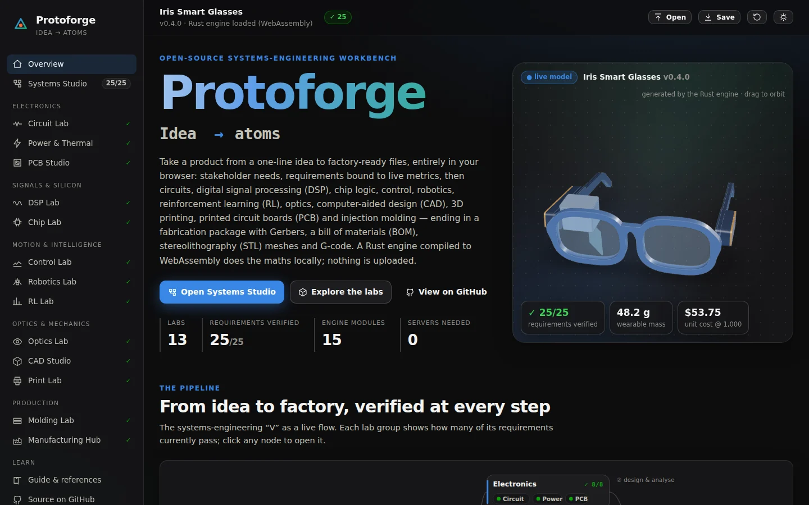

</div>

---

## What is this?

Building a physical product means crossing a dozen disciplines — circuits, signal processing, chips, control, optics, mechanical design, printing, printed circuit boards, molding, cost — and keeping all of them honest against the same list of requirements. Protoforge puts that whole journey into one web app:

1. **Describe the product** in the **Systems Studio**: problem, stakeholder needs, requirements, architecture, trade studies, risks and milestones.
2. **Bind every requirement to a number a simulation computes** (for example `R-012: rail droop ≤ 50 mV` ← the Circuit Lab's transient simulation).
3. **Design in 13 engineering labs** — each is a real simulator or generator written in Rust, with interactive visuals and the maths explained, and every change re-verifies all requirements live.
4. **Download the fabrication package**: Gerbers, drill file, bill of materials (BOM) and component placement list (CPL) for a printed circuit board (PCB) assembly service, STL meshes and G-code for 3D printing, a molding design-for-manufacturing (DFM) report, cost estimates, step-by-step ordering guides and the verification report.

The worked example is **Iris** — monocular heads-up-display smart glasses designed from scratch. All **25 of its requirements are verified by simulation**, and along the way the tool caught real design bugs (see [What the simulations caught](#what-the-simulations-caught)).

> Everything runs in your browser. The Rust engine is compiled to WebAssembly, so nothing is uploaded and GitHub Pages is the only hosting needed. The same engine also runs as a command-line tool and as a local REST server.

<div align="center">
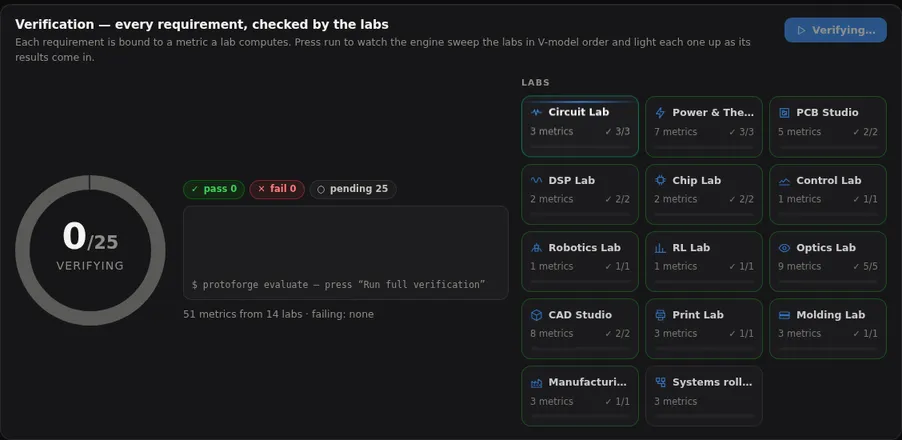
<br/><sub>“Run full verification” in the Systems Studio: every lab's analyses run in Rust and each requirement lights up.</sub>
</div>

---

## Contents

- [The labs](#the-labs)
- [Iris: smart glasses from scratch](#iris-smart-glasses-from-scratch)
- [What the simulations caught](#what-the-simulations-caught)
- [Quick start](#quick-start)
- [Command-line tool](#command-line-tool)
- [REST server](#rest-server)
- [Build anything: your own product](#build-anything-your-own-product)
- [Architecture](#architecture)
- [Honest scope: what is real and what is approximate](#honest-scope-what-is-real-and-what-is-approximate)
- [Reference projects and further learning](#reference-projects-and-further-learning)
- [Repository layout](#repository-layout)
- [Contributing](#contributing)

---

## The labs

Every lab reads the same product model, teaches the maths behind it with equations and references, publishes metrics that verify requirements, and lets you download what it produces. Each has a detailed guide in [`docs/labs/`](docs/labs).

### Systems Studio — the front door

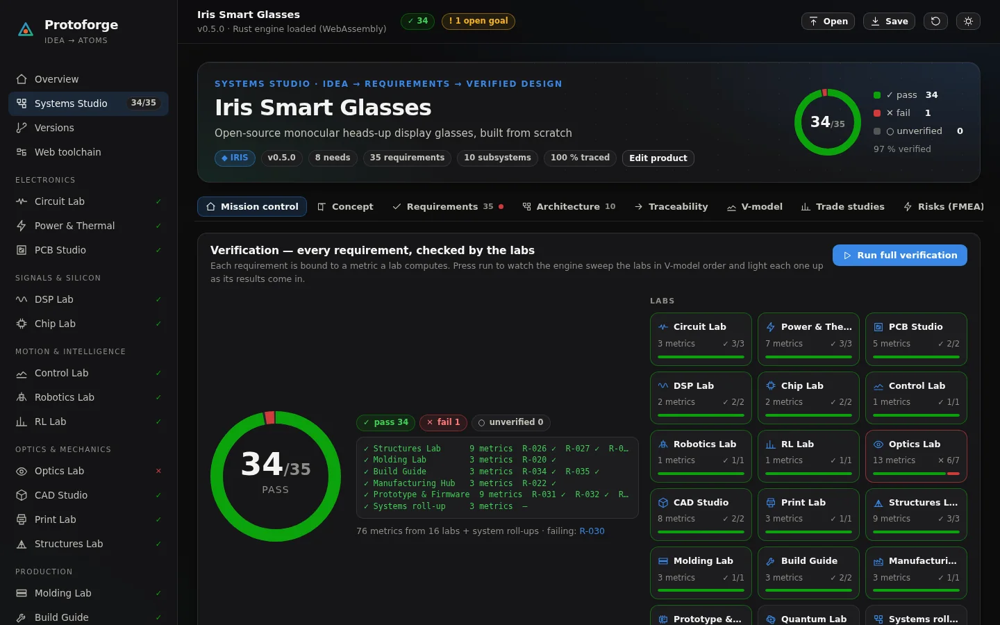

The heart of Protoforge. Eleven tabs cover the systems-engineering life cycle:

| Tab | What you do there |
|---|---|
| **Mission control** | Verification ring, requirement status by lab, top risks, budget margins, “Run full verification” sweep |
| **Concept** | Problem, vision, users, use cases, constraints |
| **Requirements** | Filterable table with live values and margins; add/edit requirements and bind them to any metric the engine produces; International Council on Systems Engineering (INCOSE)-style requirement-quality lint; per-requirement trace and history |
| **Architecture** | Subsystem block diagram with animated interfaces (I²C, SPI, PDM, power…), N-squared (N²) interface matrix, bill of materials per subsystem |
| **Traceability** | Layered graph need → requirement → subsystem → metric → lab; click any node to highlight everything it affects |
| **V-model** | Animated systems-engineering “V” with live status at every level |
| **Trade studies** | Weighted decision matrices, sensitivity tornado charts, radar charts; flags decisions that disagree with the scores |
| **Risks** | Failure Mode and Effects Analysis (FMEA) with risk priority numbers (RPN) and a severity × occurrence heat map |
| **Budgets** | Mass, power and cost roll-ups with margins |
| **Roadmap** | Stage gates from concept through engineering, design and production validation (EVT, DVT, PVT) with automatically checked exit criteria |
| **Report & templates** | Markdown verification report, project JSON, and templates to start a new product (Blank, Iris, a sensor tag, a desk robot) |

### Electronics

| | |
|---|---|
| 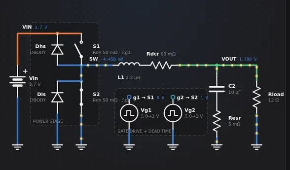 | **Circuit Lab** — a SPICE-style simulator (Simulation Program with Integrated Circuit Emphasis) in Rust: modified nodal analysis (MNA), Newton–Raphson with junction limiting, trapezoidal transient with breakpoints, AC small-signal analysis. Level-1 MOSFETs, diodes, switches, controlled sources. Ten presets (the Iris 1.8 V rail, 2 MHz buck converter, battery-sense divider, IR LED driver, capacitive touch, CMOS inverter, anti-alias filter, op-amp preamp, RLC, rectifier) with **animated schematics where current visibly flows**, live sliders, and ngspice-compatible netlist export. [Guide](docs/labs/circuit.md) |
| 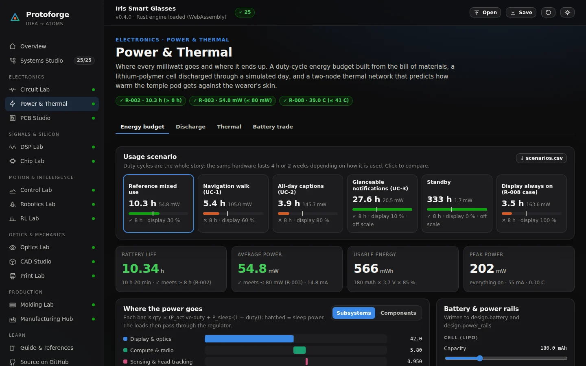 | **Power & Thermal** — duty-cycle energy budget from the bill of materials, lithium-polymer discharge with an open-circuit-voltage curve and internal resistance, a two-node thermal network that predicts skin temperature, firmware throttling, and a battery-capacity trade (life vs mass). [Guide](docs/labs/power.md) |
| 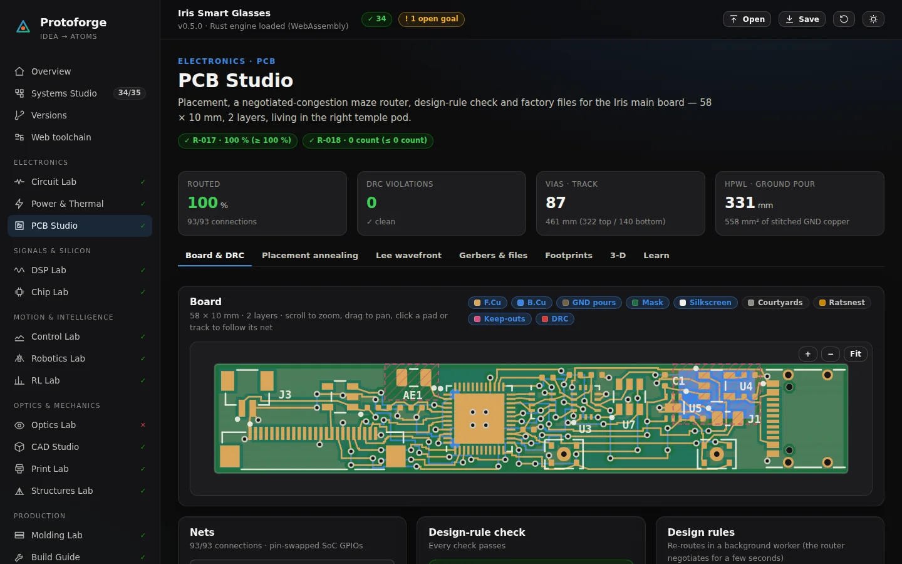 | **PCB Studio** — footprint library, constraint-driven placement with simulated annealing, a negotiated-congestion Lee maze autorouter on two layers with an **animated routing wavefront**, design-rule check (DRC), ground pours, and Gerber X2, Excellon drill, BOM and CPL export in the column format PCB assembly services expect. [Guide](docs/labs/pcb.md) |

### Signals & silicon

| | |
|---|---|
| 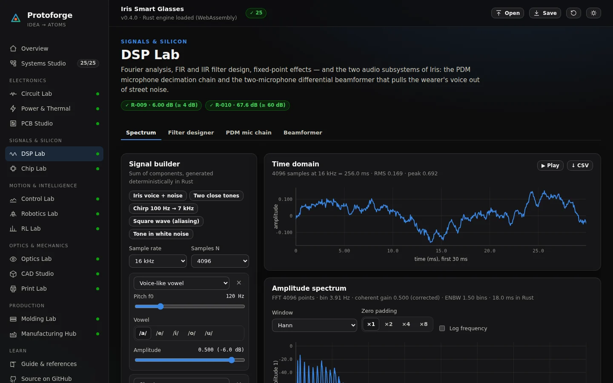 | **DSP Lab** — digital signal processing: fast Fourier transform (FFT) and windows, finite and infinite impulse response (FIR/IIR) filter design with pole-zero plots, fixed-point effects, the Iris **pulse-density-modulation (PDM) microphone chain** (sigma-delta modulator → cascaded integrator-comb (CIC) decimator → compensation FIR), and a **two-microphone differential beamformer** with polar patterns and directivity index. You can listen to signals before and after filtering. [Guide](docs/labs/dsp.md) |
| 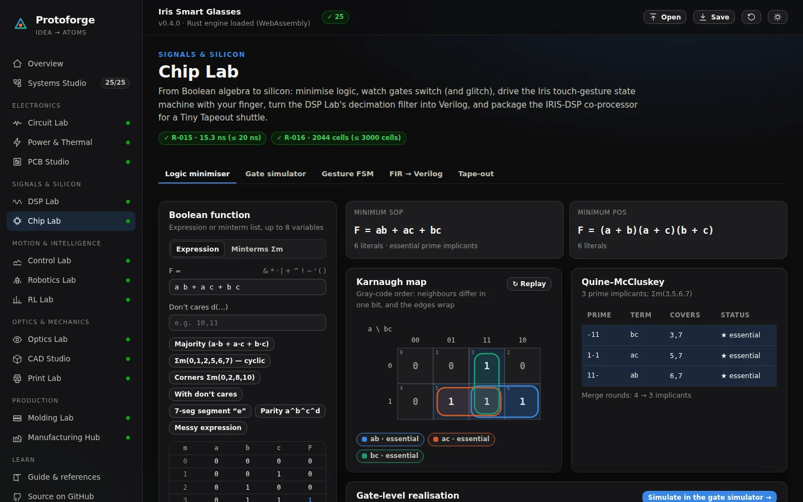 | **Chip Lab** — Boolean minimisation (Quine–McCluskey with animated Karnaugh maps), an event-driven gate simulator that shows glitches, the Iris touch-gesture finite-state machine you can drive with a button, an **FIR-to-Verilog generator** (canonical signed digits, multiply-accumulate architecture) with cell-count and timing estimates, and a **Tiny Tapeout** wrapper export. The generated Verilog was verified with Icarus Verilog, Yosys and Verilator. [Guide](docs/labs/chip.md) |

### Motion & intelligence

| | |
|---|---|
| 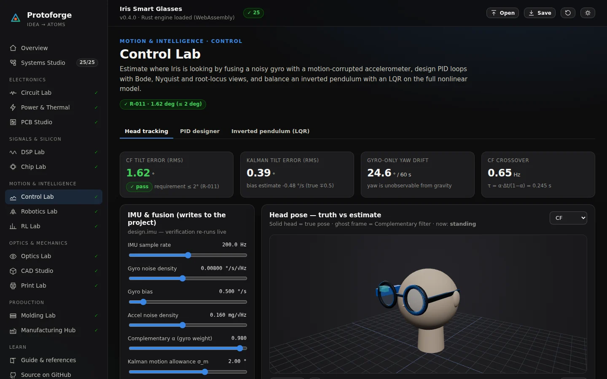 | **Control Lab** — head tracking from a simulated inertial measurement unit (IMU) with complementary and Kalman filters on a 3D head model; a proportional-integral-derivative (PID) designer with Bode plots, margins, root locus and auto-tuning; a nonlinear inverted pendulum balanced by a linear-quadratic regulator (LQR). [Guide](docs/labs/control.md) |
| 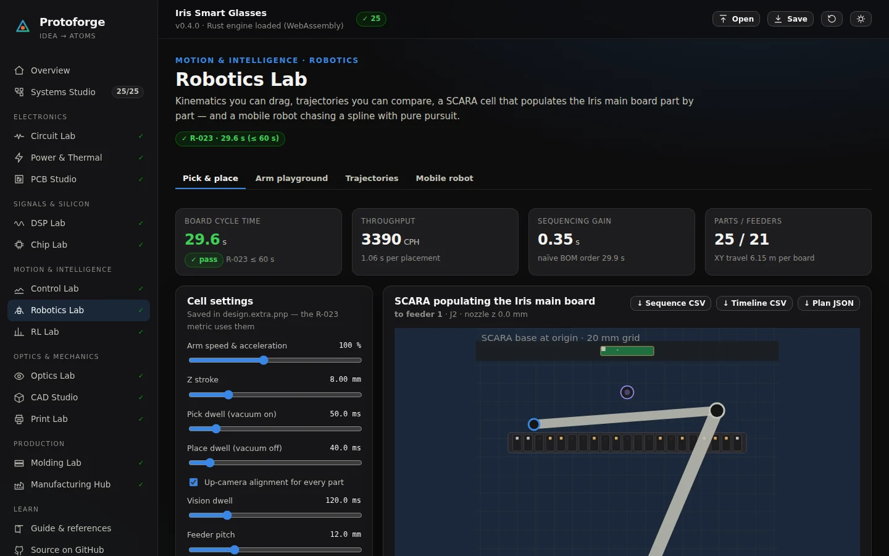 | **Robotics Lab** — two-link arm kinematics and Jacobians, trapezoidal/cubic/quintic trajectories, a **SCARA robot that populates the Iris board part by part** with a cycle-time breakdown, and a pure-pursuit mobile robot. [Guide](docs/labs/robotics.md) |
| 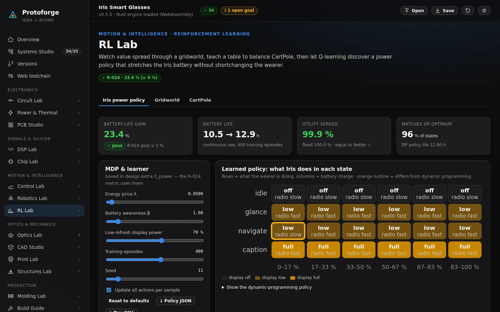 | **RL Lab** — reinforcement learning: value iteration and Q-learning on an editable gridworld with animated values, CartPole, and a **learned power-management policy** for Iris that extends battery life by about 23 % without hurting the wearer's experience. [Guide](docs/labs/rl.md) |

### Optics & mechanics

| | |
|---|---|
| 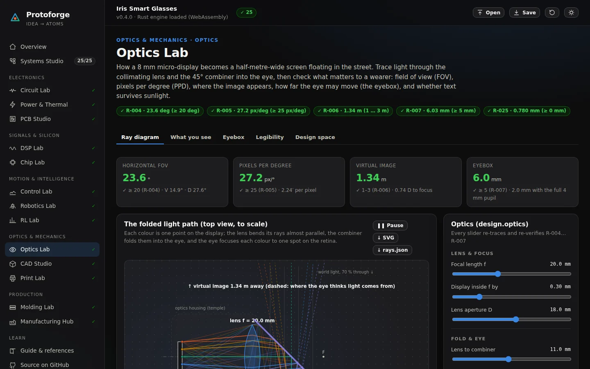 | **Optics Lab** — paraxial ray tracing of the display (micro-display → lens → 45° combiner → eye) with animated light, field of view (FOV), pixels per degree (PPD), virtual-image distance, eyebox, legibility and a first-person “what you see” view that washes out in sunlight. [Guide](docs/labs/optics.md) |
| 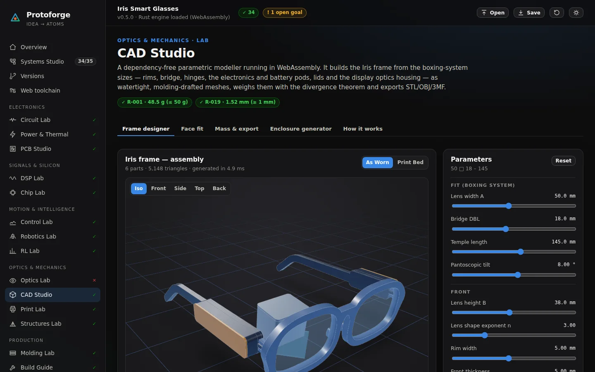 | **CAD Studio** — a dependency-free parametric modeller: polygon triangulation, extrusion with molding draft, sweeps, hollow pods. Generates the whole Iris frame from eyewear sizes (lens width – bridge – temple length), with exploded views, mass properties, a face-fit helper, STL/OBJ/3MF export, and a generic **enclosure generator** for anything else you build. [Guide](docs/labs/cad.md) |
| 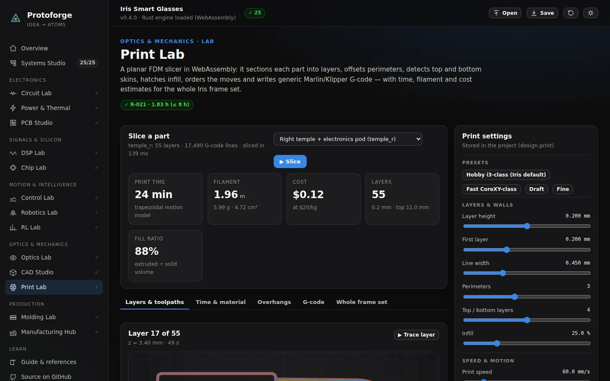 | **Print Lab** — a planar slicer: perimeters by polygon offsetting, rectilinear infill, top/bottom skins, overhang detection, Marlin/Klipper G-code, time and filament estimates, and layer-by-layer toolpath previews. [Guide](docs/labs/print.md) |

### Production

| | |
|---|---|
| 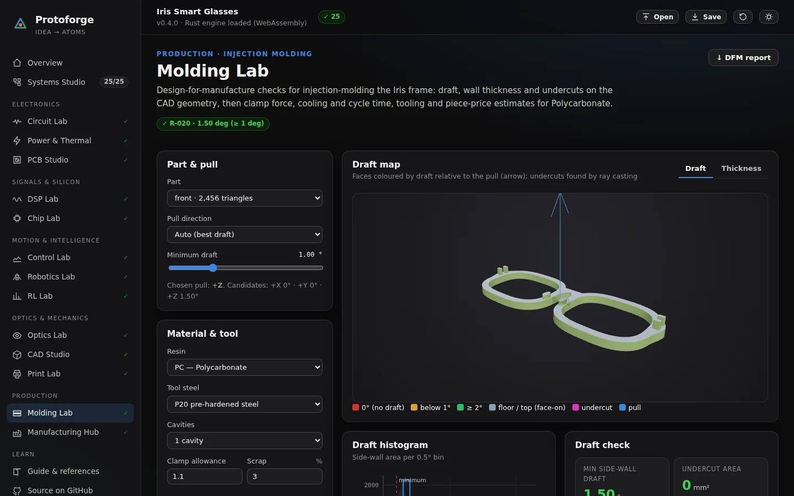 | **Molding Lab** — injection-molding DFM: draft-angle heat maps, undercut detection, wall thickness by ray casting, clamp force, cooling and cycle time, tooling and piece cost, animated molding cycle. [Guide](docs/labs/molding.md) |
| 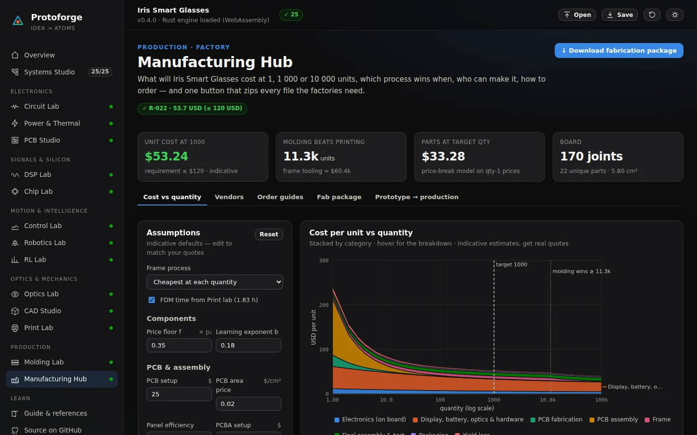 | **Manufacturing Hub** — cost per unit vs quantity by category (3D printing vs urethane casting vs injection molding crossover), a vendor directory (PCB fabrication and assembly, parts distributors, printing/CNC/molding services), ordering guides, the prototype-to-production path, and the one-click **fabrication package** zip. [Guide](docs/labs/mfg.md) |

<div align="center">
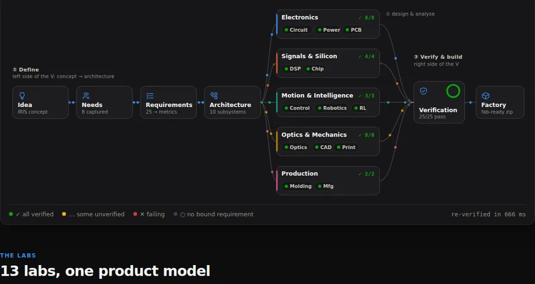
<br/><sub>The overview page's live pipeline: each node shows how many of its requirements currently pass.</sub>
</div>

### Light theme and phones

Every page has a dark and a light theme (the sun/moon button) and works down to phone width.

<p align="center">
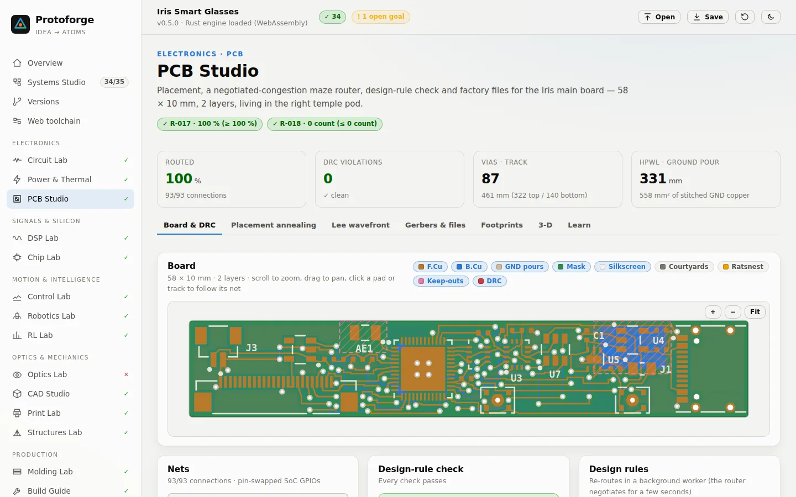
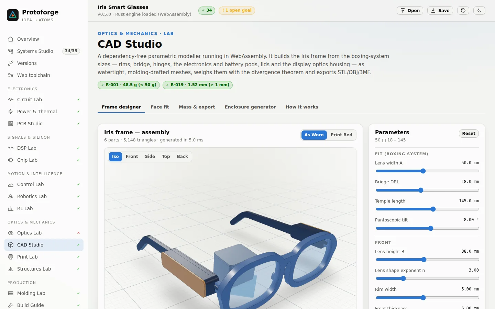
</p>
<p align="center">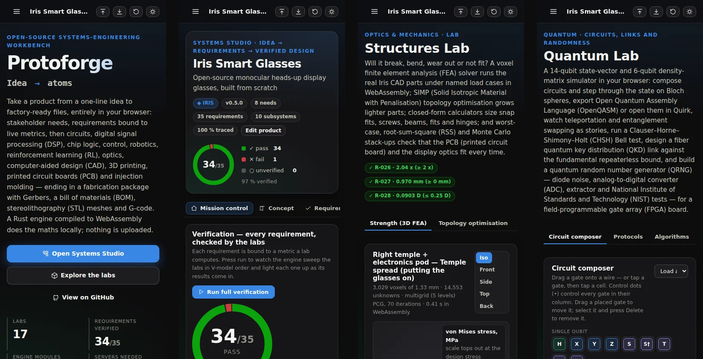</p>

---

## Iris: smart glasses from scratch

Iris is a pair of glasses with a 640 × 400 micro-OLED display in the right eye, two microphones, head tracking, a touch strip and a Bluetooth Low Energy link to a phone. Its whole definition lives in one file, [`examples/smart-glasses/project.json`](examples/smart-glasses/project.json): 8 needs, 25 requirements, 10 subsystems, 10 interfaces, 32 BOM lines, 4 trade studies, 8 FMEA risks, 6 milestones, and the design parameters every lab reads.

Current verification (`protoforge evaluate`):

| ID | Requirement | Value | Target | Verified by |
|---|---|---|---|---|
| R-001 | Total wearable mass | 48.2 g | ≤ 50 g | CAD Studio + BOM |
| R-002 | Battery life, mixed use | 10.3 h | ≥ 8 h | Power & Thermal |
| R-003 | Average system power | 54.8 mW | ≤ 80 mW | Power & Thermal |
| R-004 | Horizontal field of view | 23.6° | ≥ 20° | Optics Lab |
| R-005 | Angular resolution | 27.2 px/° | ≥ 25 px/° | Optics Lab |
| R-006 | Virtual image distance | 1.34 m | 1–3 m | Optics Lab |
| R-007 | Eyebox width | 6.0 mm | ≥ 5 mm | Optics Lab |
| R-008 | Skin temperature, display always on, 30 °C | 39.0 °C | ≤ 41 °C | Power & Thermal |
| R-009 | Microphone directivity index at 1 kHz | 6.0 dB | ≥ 4 dB | DSP Lab |
| R-010 | Decimation-filter stopband attenuation | 67.6 dB | ≥ 60 dB | DSP Lab |
| R-011 | Head-orientation error | 1.62° RMS | ≤ 2° | Control Lab |
| R-012 | 1.8 V rail droop on display turn-on | 7.5 mV | ≤ 50 mV | Circuit Lab |
| R-013 | Buck converter ripple | 1.5 mV | ≤ 30 mV | Circuit Lab |
| R-014 | Battery-sense divider current | 1.68 µA | ≤ 2 µA | Circuit Lab |
| R-015 | Co-processor critical path at 50 MHz | 15.3 ns | ≤ 20 ns | Chip Lab |
| R-016 | Co-processor standard-cell count | 2044 | ≤ 3000 | Chip Lab |
| R-017 | PCB nets routed | 100 % | 100 % | PCB Studio |
| R-018 | Design-rule violations | 0 | 0 | PCB Studio |
| R-019 | PCB fits the temple pod | 1.5 mm margin | ≥ 1 mm | CAD + PCB |
| R-020 | Molding draft on side walls | 1.5° | ≥ 1° | Molding Lab |
| R-021 | Prototype frame print time | 1.8 h | ≤ 8 h | Print Lab |
| R-022 | Unit cost at 1,000 units | $53.75 (indicative) | ≤ $120 | Manufacturing Hub |
| R-023 | Pick-and-place cycle per board | 29.6 s | ≤ 60 s | Robotics Lab |
| R-024 | Learned power policy battery gain | +23.4 % | ≥ 5 % | RL Lab |
| R-025 | Combiner clears the collimating lens | 0.78 mm | ≥ 0 mm | Optics Lab |

Change any parameter in any lab — lens focal length, battery capacity, bridge width, display duty cycle — and the table re-verifies in the background within a fraction of a second.

## What the simulations caught

The point of binding requirements to simulations is that the numbers argue back. While Iris was being built, the labs found three real problems in the first design (v0.3), which v0.4 fixed:

- **An over-voltage on an input pin.** The Circuit Lab's battery-sense preset showed that the original 1 MΩ / 1.2 MΩ divider puts **2.29 V on the 1.8 V system-on-chip's analog input** when the cell is full. The divider current requirement still passed, so a requirements table alone would never have flagged it. The divider is now 1.5 MΩ / 1 MΩ (1.68 V, 1.68 µA).
- **Optics that could not be assembled.** The Optics Lab's ray trace showed that an 18 mm lens only 8 mm from a 45° combiner makes the two parts intersect. The layout moved to 11 mm, and a new requirement (R-025) now guards it.
- **An architecture that could not close timing.** The Chip Lab showed that a straightforward transposed-form FIR filter would need 57 ns and 3,586 cells; the decimating multiply-accumulate architecture meets 15 ns and 2,044 cells. The comparison stays visible in the lab.

The PCB Studio also lists parts a production board would still need (USB-C configuration-channel resistors, a crystal and radio matching network for the system-on-chip, a status pull-up) — see [Honest scope](#honest-scope-what-is-real-and-what-is-approximate).

---

## Quick start

**Use it:** open the [live app](https://normansrule.github.io/protoforge/). Nothing to install.

**Run it locally** (Ubuntu or Windows Subsystem for Linux (WSL2); full instructions in [docs/getting-started.md](docs/getting-started.md)):

```bash
# prerequisites: Rust (rustup), Node 22
rustup target add wasm32-unknown-unknown
cargo install --locked wasm-bindgen-cli --version 0.2.129

git clone git@github.com:Normansrule/protoforge.git
cd protoforge
./scripts/build-wasm.sh            # Rust engine -> web/src/wasm
cd web && npm ci && npm run dev    # http://localhost:5173
```

**Checks:**

```bash
cargo test --workspace             # ~300 engine tests + server tests
cargo clippy --workspace --all-targets -- -D warnings
(cd web && npm run build)          # TypeScript strict + production build
```

**Deploy your own copy:** push to GitHub, then in the repository go to *Settings → Pages → Source: GitHub Actions*. The [`pages.yml`](.github/workflows/pages.yml) workflow builds the WebAssembly engine and the site and publishes it on every push to `main`.

---

## Command-line tool

The same engine, headless. Build it with `cargo build --release -p forge-cli`:

```text
protoforge evaluate [project.json]              verify every requirement (exit code 1 if any fail)
protoforge metrics  [project.json]              every metric the labs compute, with notes
protoforge report   [project.json]              Markdown verification report
protoforge package  [project.json] [--out DIR]  write the full fabrication package
protoforge lint     [project.json]              structural and requirement-quality checks
protoforge call <method> [json | @file.json]    call any engine method
protoforge methods                              list engine modules
protoforge new "<name>" > my-product.json       blank project template
```

With no project path the embedded Iris project is used. `protoforge package` writes about 36 files:

```text
out/iris/
├── README.md                      index of everything below
├── pcb/                           Gerber X2 layers, Excellon drill, BOM.csv, CPL.csv, fab notes
├── cad/                           binary STL per frame part (print orientation) + assembly.obj
├── print/                         G-code per part
├── molding/molding-dfm-report.md  draft, undercuts, walls, clamp force, cycle, tooling
├── cost/                          cost vs quantity (CSV + report)
├── guides/                        how to order: PCB assembly, 3D printing, injection molding
├── verification-report.md         every requirement with its value and source
└── project.json
```

Continuous integration runs `protoforge evaluate` on every push, so a change that breaks a requirement fails the build — and the fabrication package is attached to every run as an artifact.

## REST server

`cargo run --release -p forge-server -- --port 8787 --static web/dist` serves the app and exposes every engine method over HTTP for notebooks, scripts or other tools:

```bash
curl localhost:8787/api/health
curl -X POST localhost:8787/api/optics.analyze -d '{}'
curl -X POST localhost:8787/api/package --data-binary @examples/smart-glasses/project.json -o iris-fab.zip
curl -X POST localhost:8787/api/ngspice -d '{"netlist":"..."}'   # cross-check a deck in ngspice if installed
```

See [`crates/forge-server/README.md`](crates/forge-server/README.md).

---

## Build anything: your own product

Protoforge is not an Iris viewer; Iris is just the first project. To start your own:

1. **Systems Studio → Report & templates → New project.** Start blank or from a template (Iris, a wearable sensor tag, a desk robot). Or `protoforge new "My thing" > my-thing.json`.
2. **Concept and needs.** Write the problem, the users and what they need.
3. **Requirements bound to metrics.** In the requirement form, pick any metric the engine produces (the picker shows its current value) and a criterion. Requirements without a metric stay “unverified” until you verify them by test or inspection.
4. **Design in the labs.** Edit the design parameters, BOM and power profiles; paste your own SPICE decks into the Circuit Lab; generate an enclosure in the CAD Studio; design filters and export Verilog; tune controllers.
5. **Iterate until green**, watching trade studies, risks and budgets update.
6. **Download the fabrication package** and follow the ordering guides — then graduate the design into professional tools (below).

The whole product is one JSON document ([schema in `project.rs`](crates/forge-core/src/project.rs)); save it with the **Save** button, keep it in Git, and open it again with **Open**.

---

## Architecture

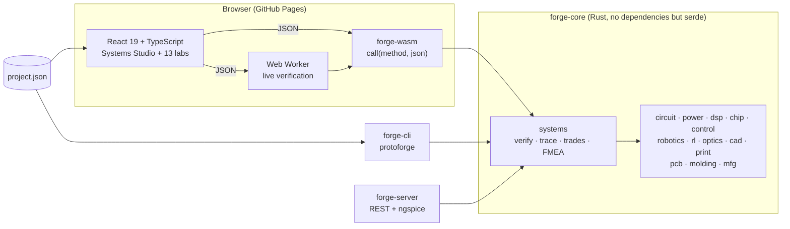

- **One JSON method API.** Every capability is `module.method` with JSON in and out — 120 methods across 15 modules. The browser calls it through WebAssembly (`call("dsp.fft", {...})`), the server over HTTP (`POST /api/dsp.fft`), the CLI directly. The method catalog is generated from the source at build time (`api.catalog`).
- **Metrics bind to requirements.** Each module exposes `metrics(project)`; `systems.evaluate` collects 50+ metrics and checks every requirement's criterion. Expensive analyses are memoised on exactly the inputs they read, and the browser runs the full verification in a Web Worker, so re-verifying all 25 requirements never blocks the page (each lab's own interactive analysis runs directly and takes milliseconds).
- **Dependency-free engine.** `forge-core` depends only on `serde`/`serde_json` — its own linear algebra, polynomial roots, FFT, mesh kernel, slicer, router and simulator — so it compiles to a single ~4 MB WebAssembly module.
- **Deterministic.** All randomness is seeded, so a project gives the same results every run. Native builds (CLI, CI) and WebAssembly use different floating-point math libraries, so a few geometry-derived numbers can differ in the last digits between the browser and the CLI; no requirement verdict changes.

Details: [docs/architecture.md](docs/architecture.md). Adding a lab: [docs/CONTRIBUTING-LABS.md](docs/CONTRIBUTING-LABS.md).

---

## Honest scope: what is real and what is approximate

Protoforge is built to teach and to get a design to a credible first prototype quickly. It is not a replacement for professional tools, and it says so wherever it matters.

| Area | Real | Approximate — graduate to |
|---|---|---|
| Circuits | MNA, Newton–Raphson, trapezoidal transient, AC analysis; results match hand calculations in tests | Level-1 MOSFETs only, dense matrices, no subcircuits → **ngspice**, Xyce, KiCad's simulator |
| PCB | Real placement, maze routing, DRC and syntactically valid Gerber X2 / Excellon / BOM / CPL files | Grid routing only (no 45°, impedance or length matching); illustrative pinout and approximate land patterns; missing parts listed above → **KiCad** + FreeRouting, check with **gerbv** |
| Chips | Verilog verified with Icarus Verilog, Yosys and Verilator | Cell counts and timing from a first-order model (flip-flop counts match Yosys) → **Yosys**, **OpenLane 2 / OpenROAD**, Tiny Tapeout |
| CAD | Closed meshes, exact volumes, drafted walls | Mesh modeller, not exact solids; some parts are several closed shells touching face-to-face (slicers merge them, but may report non-manifold edges); no STEP export → **Onshape**, FreeCAD, build123d, CadQuery |
| Printing | Working slicer and G-code | Rectilinear infill only, no supports → **Bambu Studio**, OrcaSlicer, PrusaSlicer |
| Optics | Paraxial ray tracing, correct first-order quantities | No aberrations, single wavelength → rayoptics, Zemax OpticStudio |
| Thermal / power | Energy budgets, discharge and RC-network transients | Lumped models, typical cell curves → finite-element analysis (Elmer, FreeCAD FEM), PyBaMM |
| Cost and vendors | Transparent parametric models with editable assumptions | **Indicative only — get real quotes.** Vendor entries list only names, URLs and service types; part numbers are left for you to fill in |

---

## Reference projects and further learning

- **[docs/reference-repos.md](docs/reference-repos.md)** — 50 mature open-source projects to study and to cross-check each lab against (ngspice, Xyce, KiCad, FreeRouting, Yosys, OpenROAD, OpenLane 2, Tiny Tapeout, cocotb, SciPy, GNU Radio, python-control, Drake, MuJoCo, Gymnasium, OpenSCAD, CadQuery, build123d, FreeCAD, PrusaSlicer, CuraEngine, OrcaSlicer, rayoptics, Elmer FEM, and open smart-glasses hardware such as Brilliant Labs' Frame).
- **[docs/references.md](docs/references.md)** — the consolidated bibliography (94 references: Nagel's SPICE2 thesis, Ho–Ruehli–Brennan's MNA paper, Oppenheim & Schafer, Hogenauer's CIC paper, Åström & Murray, Kalman, Sutton & Barto, Lynch & Park, Hecht, Kress, Lee's routing algorithm, the Gerber specification, Rosato's *Injection Molding Handbook*, the NASA Systems Engineering Handbook, INCOSE, and more). Every lab page cites its sources inline.
- **In the app:** *Guide & references* has a step-by-step workflow, a searchable glossary of 129 terms, and free English learning resources.

---

## Repository layout

```text
protoforge/
├── crates/
│   ├── forge-core/        the engine: one module per lab + systems engineering (~49k lines of Rust, ~300 tests)
│   ├── forge-wasm/        WebAssembly bridge: call(method, json)
│   ├── forge-cli/         `protoforge` command-line tool
│   └── forge-server/      axum REST server (+ ngspice cross-check)
├── web/                   React 19 + TypeScript + Vite app (~21k lines)
│   └── src/
│       ├── pages/         Overview, Systems Studio, Guide & references
│       ├── labs/          one folder per lab
│       ├── components/    Plot, Scene3D, UI primitives
│       ├── engine/        WebAssembly loader, hooks, Web Worker client
│       └── state/         project store + shared live verification
├── examples/smart-glasses/project.json    the Iris product definition
├── docs/                  architecture, getting started, lab guides, references
├── scripts/build-wasm.sh  Rust -> WebAssembly -> web/src/wasm
└── .github/workflows/     CI (tests, lint, verification, fab package) and Pages deployment
```

## Contributing

New labs, better models and more example products are all welcome. Start with [docs/CONTRIBUTING-LABS.md](docs/CONTRIBUTING-LABS.md): a lab is one Rust module with `dispatch` + `metrics`, one React folder, and one guide.

## License

[MIT](LICENSE) © 2026 Aleksander Norman.
