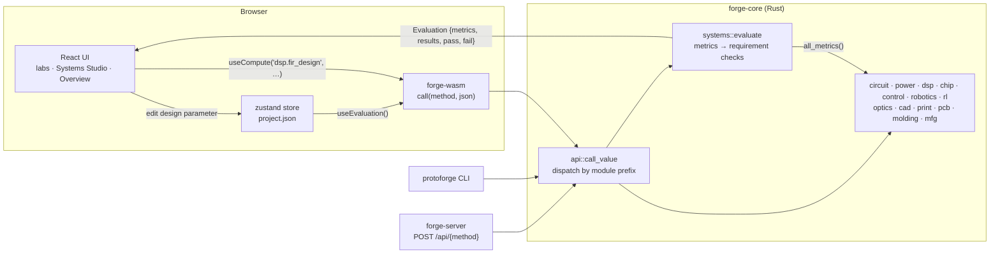

# Architecture

Protoforge is a browser-native systems-engineering workbench: a **Rust
engine** compiled to **WebAssembly (WASM)** and driven by a **React +
TypeScript** user interface (UI). The same engine crate also powers a
command-line interface (CLI) and a local representational state transfer
(REST) server, all through one JavaScript Object Notation (JSON) method
API. Nothing needs a backend: the site on GitHub Pages is static
files plus one `.wasm` binary.

## Repository map

```
protoforge/
├── crates/
│   ├── forge-core/      the engine — pure Rust, depends only on serde + serde_json
│   │   └── src/
│   │       ├── api.rs       JSON method dispatch: call(method, input) → {ok} | {error}
│   │       ├── project.rs   the product model (needs, requirements, design parameters…)
│   │       ├── systems/     verification, traceability, trade studies, failure mode and effects analysis (FMEA), lint, report
│   │       ├── memo.rs      one-entry memo caches for expensive analyses
│   │       ├── math.rs      complex numbers, dense solve, polynomial roots, seeded random numbers …
│   │       └── circuit/ power/ dsp/ chip/ control/ robotics/ rl/ optics/
│   │           cad/ print/ pcb/ molding/ mfg/        one module per lab
│   ├── forge-wasm/      wasm-bindgen bridge: exports call() and version()
│   ├── forge-cli/       `protoforge` binary: evaluate, metrics, report, package, lint, call, methods, new
│   └── forge-server/    axum REST server: /api/{method}, /api/package, /api/ngspice, static hosting
├── web/                 React 19 + Vite front end
│   └── src/
│       ├── engine/      engine.ts (load + call), hooks.ts (useCompute), types.ts (mirror of project.rs)
│       ├── state/       project.ts — zustand store holding the one project JSON + useEvaluation()
│       ├── components/  Card, Stat, Slider, Plot, Scene3D, LabPage, Explainer …
│       ├── labs/        one folder per lab + registry.ts (routes, groups, metric prefixes)
│       └── pages/       Home (overview), Systems (studio), Learn (guide & references)
├── examples/smart-glasses/project.json   Iris, the reference product (embedded in the engine)
├── scripts/build-wasm.sh                 Rust → web/src/wasm
├── docs/                                 this file, getting started, lab guides, references
└── .github/workflows/                    ci.yml, pages.yml
```

## Data flow



1. **One product model.** Everything about the product lives in one JSON
   document (`Project` in `project.rs`, mirrored by `web/src/engine/types.ts`):
   concept, stakeholder needs, requirements, subsystems, interfaces,
   components with power profiles, trade studies, risks, milestones and a
   `design` section with every lab's parameters (frame dimensions, battery,
   optics, audio, inertial measurement unit (IMU), printed circuit board (PCB),
   thermal, manufacturing, print and chip settings, and Simulation Program with
   Integrated Circuit Emphasis (SPICE) netlists).
2. **Labs read and patch it.** A lab reads `useProject((s) => s.project)` and
   edits with `patchDesign('frame', { bridge_mm: 20 })`. The store persists to
   `localStorage` and can be saved/opened as a file from the top bar.
3. **Every edit re-verifies.** `useEvaluation()` calls `systems.evaluate` with
   the whole project; the sidebar dots, requirement strips, the Overview
   pipeline and the Systems Studio all read that one result.

## The JSON method API

Every capability is a dotted method name: `"<module>.<verb>"`, e.g.
`circuit.simulate`, `dsp.fir_design`, `cad.stl`, `mfg.package`.

```rust
// crates/forge-core/src/api.rs
pub fn call_value(method: &str, input: &Value) -> Result<Value, String>;
pub fn call(method: &str, input_json: &str) -> String; // {"ok": …} | {"error": "…"}
```

`api::DISPATCHERS` maps the module prefix to that module's
`dispatch(method, input) -> Option<ApiResult>`; `None` means "unknown
method". Inputs and outputs are serde structs with `snake_case` fields and
`#[serde(default)]` so callers may omit fields. `api.methods` lists the
modules.

The same call from each front door:

| Where | Call |
|---|---|
| Browser (TypeScript) | `call('pcb.ipc2221', { current_a: 0.5 })` or `useCompute('pcb.ipc2221', input)` |
| CLI | `protoforge call pcb.ipc2221 '{"current_a":0.5}'` |
| REST | `curl -X POST localhost:8787/api/pcb.ipc2221 -d '{"current_a":0.5}'` |
| Rust | `forge_core::api::call_value("pcb.ipc2221", &json!({"current_a": 0.5}))` |

In the browser, calls are **synchronous** (WebAssembly runs on the main
thread); `useCompute` passes its input through `useDeferredValue` so dragging
a slider stays smooth. Long jobs (the PCB autorouter) run in a Web Worker
that loads its own copy of the engine.

## How metrics bind to requirements

Each module exposes `metrics(&Project) -> Vec<Metric>`: named, unit-carrying
numbers such as `circuit.rail_droop_mv = 7.5 mV` with a human note on how it
was computed. `systems::all_metrics` collects them from every module and adds
cross-domain ones (`mass.total_g`, `bom.cost_usd`, `fit.pcb_pod_margin_mm`).

A requirement's `verification` names one metric key and a criterion:

```json
{ "id": "R-012", "text": "The 1.8 V rail shall droop by at most 50 mV …",
  "verification": { "method": "analysis", "metric": "circuit.rail_droop_mv", "cmp": "le", "target": 50, "unit": "mV" } }
```

`systems::evaluate` looks the metric up and applies `le`, `ge`, `eq` (with
tolerance) or `between`, producing pass / fail / unverified plus a signed
margin. The UI groups requirements by lab through the metric **prefixes** in
`web/src/labs/registry.ts` (e.g. the Power & Thermal lab owns `power.` and
`thermal.`), which is how the Overview pipeline and the sidebar know each
lab's status.

## Memoisation

Verification re-runs every module's `metrics()` on every edit, and most edits
touch one lab. Expensive modules (manufacturing cost, molding analysis,
robotics pick-and-place planning …) therefore cache their last result in a
one-entry, thread-local memo keyed on the exact inputs they read
(`forge_core::memo::memo(&SLOT, memo::key(&inputs), || compute())`). Editing
the frame's bridge width recomputes CAD, print, molding and cost metrics but
reuses the circuit, digital signal processing (DSP) and control results. The
budget is roughly 20 ms per module in release WebAssembly.

## Adding a lab

See [CONTRIBUTING-LABS.md](CONTRIBUTING-LABS.md) for the full conventions. In short:

1. `crates/forge-core/src/<module>/mod.rs` with `dispatch` and `metrics`; add
   it to `api::DISPATCHERS` and `systems::all_metrics`; unit tests against
   hand-calculable cases and the Iris project.
2. `web/src/labs/<lab>/index.tsx` wrapped in `<LabPage metricPrefixes={['<module>.']}>`,
   plus one entry in `web/src/labs/registry.ts`.
3. `docs/labs/<lab>.md` with the maths, limitations, the professional tools to
   graduate to and references; add new citations to
   `web/src/pages/learn/references.ts` and regenerate `docs/references.md`.
4. Bind Iris requirements to the new metric keys in `examples/smart-glasses/project.json`.

## Build pipeline

```
crates/forge-core ──cargo build --target wasm32-unknown-unknown──▶ forge_wasm.wasm
                  ──wasm-bindgen --target web──▶ web/src/wasm/{forge_wasm.js, forge_wasm_bg.wasm}
web/ ──tsc --noEmit && vite build──▶ web/dist/ (static site, base './')
```

* `scripts/build-wasm.sh` builds the release engine (`opt-level = "s"` for the
  WASM crate, link-time optimisation for all) and generates bindings. If the
  `wasm32-unknown-unknown` target is not installed it falls back to building
  the standard library from source.
* `wasm-bindgen-cli` must match the `wasm-bindgen` crate exactly
  (**0.2.129**, pinned in `crates/forge-wasm/Cargo.toml`).
* Vite code-splits every lab (`React.lazy`), so the Overview loads only the
  core bundle; three.js arrives with the first 3D view.

## Continuous integration (CI) and deployment

`.github/workflows/ci.yml` runs on every push and pull request:

| Job | Steps |
|---|---|
| **Rust** | `cargo fmt --all -- --check` · `cargo clippy --workspace --all-targets -- -D warnings` · `cargo test --workspace` |
| **WebAssembly + web** | install the wasm target and `wasm-bindgen-cli` 0.2.129 · `./scripts/build-wasm.sh` · `npm ci && npm run build` · upload `web/dist` |
| **Verify Iris** | `protoforge evaluate` (fails the build if any requirement fails) · `lint` · Markdown report into the job summary · `protoforge package` uploaded as the **`iris-fab-package`** artifact |

`.github/workflows/pages.yml` builds the same site on pushes to `main` (or
manually) and publishes it with `actions/upload-pages-artifact` and
`actions/deploy-pages`. One-time setup: **Settings → Pages → Build and
deployment → Source: GitHub Actions**. Routing uses hash URLs (`#/circuit`),
so no server rewrites are needed; the workflow also copies `index.html` to
`404.html` and adds `.nojekyll`.

## The local REST server

`crates/forge-server` (axum 0.8 + Tokio) wraps the same engine for scripts and
notebooks — see its [README](../crates/forge-server/README.md). Engine calls
run on Tokio's blocking pool; `POST /api/package` streams the fabrication
package as a zip; `POST /api/ngspice` cross-checks Circuit Lab decks against a
locally installed ngspice; `--static web/dist` serves the app from the same
origin.
