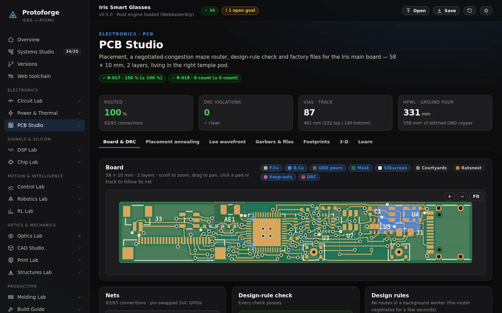

# Web toolchain

Route: `#/toolchain` · Engine: `crates/forge-core/src/bridge/` · UI: `web/src/pages/Toolchain.tsx`, `web/src/pages/toolchain/`

Protoforge simulates and verifies a product in the browser; building it happens
in tools that engineers and factories already trust. The web toolchain hands
every design over as an open, documented file format — the printed circuit
board (PCB) as a KiCad project, the computer-aided design (CAD) parts as
Standard for the Exchange of Product model data (STEP, ISO 10303) files and a
parametric OpenSCAD program, stereolithography (STL) meshes and G-code for
printing, Simulation Program with Integrated Circuit Emphasis (SPICE) decks and
one-click Falstad CircuitJS links for the circuits, hardware description
language (HDL) sources for the chip, and a Ray Optics scene for the heads-up
display (HUD) — and checks each export with an independent parser before you
rely on it.



## What leaves Protoforge, and where it goes

| Discipline | File | Opens in | Built from |
|---|---|---|---|
| PCB | `iris.kicad_pcb`, `iris.kicad_pro`, `iris.net`, `Protoforge.pretty/` | KiCad 7+ (desktop), KiCanvas (browser) | PCB Studio's routed layout |
| PCB | Gerber X2 + Excellon drill | tracespace viewer, any fab's quote page | PCB Studio |
| CAD / Mechanical | `iris-frame.step`, `iris-frame-print.step` | Onshape, FreeCAD, Online 3D Viewer | CAD Studio meshes |
| CAD / Mechanical | `iris-frame.scad` | OpenSCAD Playground (browser), OpenSCAD | `design.frame`, `design.optics` |
| Printing | `cad/stl/*.stl`, `print/*.gcode` | Bambu Studio / PrusaSlicer / Cura, Online 3D Viewer, NC Viewer | CAD Studio, Print Lab |
| Circuits | Falstad CircuitJS link (`?ctz=`), `*.circuitjs.txt` | Falstad CircuitJS (browser) | Circuit Lab presets + project netlists |
| Circuits | `*.cir` | ngspice | Circuit Lab decks |
| Chips / HDL | `chip/*.v` (design + testbenches) | EDA Playground, DigitalJS, 8bitworkshop | Chip Lab (IRIS-DSP) |
| Optics | `iris-hud.ray-optics.json` | Ray Optics Simulation (browser) | `design.optics` |
| Quantum | OpenQASM, Quirk links | IBM Quantum Composer, Quirk | Quantum Lab (`#/quantum`) |
| Firmware | sketches, wiring | Wokwi | Prototype & Firmware (`#/proto`) |

The **Download toolchain bundle** button zips all of it (`bridge.export_all`),
with a README per folder. Each tool card on the page also downloads just the
files that tool needs.

## Tool cards and the animated how-to strips

The **Tool map** tab opens with an animated flow — engine → files → tools →
who builds it (PCB fab, molder, your printer, a Tiny Tapeout shuttle, the
bench, quantum cloud hardware); hover a tool to trace its files, click it to
jump to its card. Every card then says what the tool is, which Protoforge file
it takes, and shows a four- or five-step **how-to strip**: small SVG
pictograms (download, unzip, open, drag-and-drop, paste, click, run, view,
edit, export, create a version) that animate one after another. The strip
pauses with its ❚❚ button, a click on a step jumps to it, and with
`prefers-reduced-motion` every step is drawn still. The same steps are written
out under “Step by step, in words”.

| Tool | Runs | What we hand it | Steps in short |
|---|---|---|---|
| [Falstad CircuitJS](https://www.falstad.com/circuit/) | browser | the circuit inside the link (`?ctz=`) | click → it simulates → right-click a part to edit |
| [ngspice](https://ngspice.sourceforge.io/) | desktop | `.cir` decks | `ngspice -b deck.cir` |
| [KiCad](https://www.kicad.org/) | desktop | KiCad project zip | unzip → open `.kicad_pro` → **B** to fill zones → design-rule check (DRC) |
| [KiCanvas](https://kicanvas.org/) | browser | `.kicad_pcb` | drag the file onto kicanvas.org, or link a copy on GitHub |
| [tracespace viewer](https://tracespace.io/view/) | browser | Gerber + drill zip | drop the zip, check both sides; fabs such as JLCPCB also render the uploaded zip on their quote page |
| [Onshape](https://www.onshape.com/) | browser | `iris-frame.step` | Import (millimetre) → re-model on the faceted reference → create a Version |
| [FreeCAD](https://www.freecad.org/) | desktop | STEP | File → Open → Part → Convert to solid |
| [OpenSCAD Playground](https://ochafik.com/openscad2) | browser | `iris-frame.scad` | paste → change `bridge = 20;` → F6 → export STL or 3D Manufacturing Format (3MF) |
| [Online 3D Viewer](https://3dviewer.net/) | browser | STL parts or STEP | drag in → orbit and measure |
| Bambu Studio / PrusaSlicer / OrcaSlicer / Cura | desktop | STL parts (print orientation) | import → polyethylene terephthalate glycol (PETG), 0.2 mm layers → slice → compare with the Print Lab |
| [NC Viewer](https://ncviewer.com/) | browser | G-code | open the file → scrub the toolpath |
| [EDA Playground](https://www.edaplayground.com/) | browser (free account) | Verilog + testbenches | testbench left, design right → Icarus Verilog + EPWave → Run |
| [DigitalJS](https://digitaljs.tilk.eu/) | browser | `iris_gesture_fsm.v` | paste → Synthesize and simulate → toggle inputs |
| [8bitworkshop](https://8bitworkshop.com/) | browser | any small module | choose the Verilog platform → paste → watch the scope |
| [Ray Optics Simulation](https://phydemo.app/ray-optics/) | browser | scene JSON | Open → the file → drag the combiner towards the lens |
| IBM Quantum Composer, [Quirk](https://algassert.com/quirk) | browser | OpenQASM, Quirk links | built by the Quantum Lab (`#/quantum`) |
| [Wokwi](https://wokwi.com/) | browser | ESP32 sketch + wiring | built by Prototype & Firmware (`#/proto`) |

Quantum and firmware exports are made on their own pages; the toolchain links
to them instead of duplicating them. The printable build steps live in the
Build Guide (`#/build`), strength checks in the Structures Lab
(`#/structures`) and the full optical ray tracer in Optics Pro (`#/optics`).

## KiCad board (`bridge.kicad_pcb`)

A KiCad 7 S-expression board (`(version 20221018)`, generator `protoforge`,
opens in KiCad 7, 8 and 9) with:

* the board outline on `Edge.Cuts`;
* every footprint with inline pads — SMD / through-hole / non-plated, rect,
  round-rect and circle shapes, sizes, drills, layers and **net assignments**
  — plus reference and value text, courtyard and fab outlines and a pin-1 dot;
* every routed track as a `segment` and every via;
* the ground pours as `zone`s on B.Cu and F.Cu with only their outline (press
  **B** in KiCad to refill them with KiCad's own clearances);
* the antenna and touch-electrode keep-outs as rule areas;
* the nets; the **net classes** (Default, Power, Ground, RF — widths from the
  IPC-2221 current rule) live in `iris.kicad_pro`, where KiCad 6+ keeps them.

Also exported: a KiCad S-expression netlist (`.net`) and the footprints as a
`Protoforge.pretty` library with an `fp-lib-table`.

### Coordinates

Protoforge measures from the board's bottom-left corner with *y* up; KiCad
from the sheet's top-left with *y* down, angles counter-clockwise on screen:

```
X = X0 + x          Y = Y0 + H − y          (X0 = 100 mm, Y0 = 80 mm on an A4 sheet)
pad local = (px, −py), pad angle = footprint angle
absolute  = anchor + R(θ)·local,  R(θ)·(x, y) = (x cos θ + y sin θ, −x sin θ + y cos θ)
```

The unit test `iris_board_parses_and_matches_the_layout` re-applies KiCad's rule
to every pad of the written file and checks it lands on PCB Studio's pad to
0.1 µm, on the same net.

### KiCanvas

[KiCanvas](https://kicanvas.org) (Thea Flowers,
[theacodes/kicanvas](https://github.com/theacodes/kicanvas)) renders KiCad
files in the browser. The quickest way is to **drag the downloaded
`iris.kicad_pcb` onto kicanvas.org**. For a shareable link on a project page it
reads the `github` (or `repo`) query parameter — see `kicanvas-shell.ts` in the
source:

1. Commit `iris.kicad_pcb` to a public GitHub repository (for example next to
   your GitHub Pages site).
2. Open `https://kicanvas.org/?github=https://github.com/<user>/<repo>/blob/<branch>/<path>/iris.kicad_pcb`.

The KiCad tab builds that link for you, and re-draws the exported file with a
small TypeScript S-expression reader (layers, nets, zones, vias, a "replay the
routing" animation) — if the file were incomplete, the picture would be too.

## STEP (`bridge.step`)

ISO 10303-21 physical file, AP214 (`AUTOMOTIVE_DESIGN`) schema, millimetres,
one `PRODUCT` per frame part with its colour:

```
PRODUCT → PRODUCT_DEFINITION → SHAPE_DEFINITION_REPRESENTATION
  → FACETED_BREP_SHAPE_REPRESENTATION
      → FACETED_BREP → CLOSED_SHELL → FACE_SURFACE (PLANE) → FACE_OUTER_BOUND → POLY_LOOP
```

Each watertight piece of a part is its own closed shell (the front is several
drafted extrusions that touch on flat faces). For every shell the page shows
the Euler characteristic χ = V − E + F = 2 − 2g: the front's main shell has
χ = −2 (two lens openings, genus 2).

**Faceted STEP is a mesh in STEP clothing.** Every face is a flat triangle, so
it is ideal for viewing, fit checks, quotes and printing services, but a mold
maker cutting steel wants native B-rep with analytic cylinders and splines —
rebuild the parts in Onshape or FreeCAD (using the STEP as reference geometry)
before tooling.

Import: Onshape — in a document, **+ → Import**; FreeCAD — **File → Open**, then
**Part → Convert to solid** if you need booleans; Online 3D Viewer
(3dviewer.net) — drag the file in.

### AP214 and AP242

STEP is split into *integrated resources* shared by every industry (Part 42
holds the geometry and topology used here) and *application protocols* (APs)
that choose what a domain exchanges. AP203 (configuration-controlled 3D
design) and AP214 (automotive design) were the classic mechanical protocols;
AP242 (*managed model-based 3D engineering*) merges them and adds product and
manufacturing information such as tolerances and annotations, which is why
current CAD systems default to it. Protoforge writes an AP214 header
(`AUTOMOTIVE_DESIGN`) because every importer accepts it and faceted geometry
needs nothing AP242 adds.

## OpenSCAD (`bridge.openscad`)

A readable, parametric OpenSCAD program: the header lists the project's
parameters under Customizer sections (`/* [Boxing system (ISO 8624)] */`, …),
the body rebuilds the frame from them — superellipse lens openings
(`|x/a|ⁿ + |y/b|ⁿ = 1` as a `polygon`), offset rims, a bridge bar, endpieces,
hollow pods, temples with the ear bend and the optics housing. Draft angles
use `linear_extrude(scale = …)`: over a wall height *h* an outline of
half-width *w* shrinks by *h*·tan θ per side, so the scale is
(w − h·tan θ)/w (holes grow instead).

It is a *simplified* re-statement of CAD Studio's generator — the numbers are
the project's, the shapes are close. Paste it into the
[OpenSCAD Playground](https://ochafik.com/openscad2) (OpenSCAD compiled to
WebAssembly), change `bridge = 20;`, press F6, export STL.

## Falstad CircuitJS (`bridge.falstad`)

CircuitJS stores a circuit as text: a `$` options line, then one line per
element `type x1 y1 x2 y2 flags values…` in pixels. Elements connect **only
where their end points coincide**. Protoforge reads the field layouts from the
`dump()` methods in [sharpie7/circuitjs1](https://github.com/sharpie7/circuitjs1)
(`src/com/lushprojects/circuitjs1/client/*Elm.java`):

| SPICE | CircuitJS | Notes |
|---|---|---|
| R, C, L | `r`, `c`, `l` | initial capacitor voltage / inductor current kept |
| V (DC, PULSE, SIN) | `v` | waveform 0 DC, 1 sine, 5 pulse; V(post 1) − V(post 0) = v; pulse delay → phase, width → duty; edges are ideal |
| I | `i` | DC only — a pulsed SPICE current is set to its high level (noted) |
| D, LED | `d`, `162` | forward drop at 1 A from the SPICE model: n·V_T·ln(1/I_S + 1) + R_S |
| M (level 1) | `f` | threshold = \|VTO\|, beta = KP·W/L; gate at point 1, source/drain 16 px either side of point 2 |
| S (voltage-controlled) | `s` | becomes a manual switch in its initial state (noted) |
| op-amp macro (E + RC + buffer) | `a` | CircuitJS op-amp with the macro's gain and ±15 V rails |
| wires, grounds, labels | `w`, `g`, `207` | wires split at every junction |

Parts are placed where the Circuit Lab schematic draws them (16 px per grid
unit); elements without a schematic position (your own netlists) are placed on
a grid and joined by CircuitJS named nodes. Before a link is offered the
converter **re-extracts the connectivity** exactly as CircuitJS does
(coincident posts, wires, grounds, same-name labels) and compares it with the
SPICE netlist.

The text is packed into the URL with lz-string's
`compressToEncodedURIComponent` — Lempel–Ziv–Welch (LZW) coding over UTF-16 code units, the dictionary
growing one code bit per power of two, 6 bits per URL-safe character — ported
to Rust (`bridge/lzstring.rs`) and checked against the reference JavaScript.
The link is `https://www.falstad.com/circuit/circuitjs.html?ctz=<packed text>`.

## Ray Optics Simulation (`bridge.ray_optics`)

A 2-D side view of the heads-up display for
[Ray Optics Simulation](https://phydemo.app/ray-optics/) (Yi-Ting Tu,
[ricktu288/ray-optics](https://github.com/ricktu288/ray-optics)): display pixels
as point sources, the collimating lens as an ideal lens, the combiner as a
beam splitter (transmission 1 − R), housing walls as blockers and the pupil as a
detector, at 20 px/mm. The scene uses format version 5 and only the keys in
each object's `serializableDefaults` (the app rejects unknown keys). Load it
with the app's **Open** button — its URL-hash format is LZMA-compressed and is
not generated here.

## What is verified, and how

Run on the Iris v0.4 defaults while building the page (September 2026):

| Export | Independent check | Result |
|---|---|---|
| `.kicad_pcb` | [kiutils](https://github.com/mvnmgrx/kiutils) 1.4.8 parse + write + re-parse; TypeScript reader on the page; Rust pad-position test | 28 footprints, 181 pads, 427 segments, 87 vias, 5 zones (2 GND + 3 keep-outs), 31 nets; every pad on the engine's position and net |
| `.kicad_mod`, `.kicad_pro`, `.net` | kiutils; JSON; Rust S-expression reader | 15 footprints; 4 net classes |
| STEP | [gmsh](https://gmsh.info) 4.15.2 (OpenCASCADE STEP reader) | 20 solids, 5 148 faces, 23.838 cm³ — identical to CAD Studio's `cad.frame_volume_cm3` (23.838 cm³); re-run on Iris v0.6 in October 2026 |
| `.scad` | OpenSCAD compiled to WebAssembly (npm `openscad-wasm-prebuilt` 1.2.0) | renders without warnings, 3 770 facets in about 12 s |
| Falstad links | reference lz-string 1.5.0 (JavaScript) | all 10 links decode to the exact text; Rust port = 7 reference vectors |
| Ray Optics scene | keys checked against the app's source (DATA_VERSION 5) | 13 objects, no unknown keys |
| Gerber X2 + Excellon | [gerbonara](https://pypi.org/project/gerbonara/) 1.5.0 | 7 layers parsed and identified from their file names, outline 58 × 10 mm, 93 plated + 2 non-plated drill hits; one harmless warning (G90 after the drill header, as KiCad writes it) |

**Not checked here**: opening the files in KiCad, Onshape, FreeCAD, CircuitJS,
tracespace or Ray Optics themselves — those applications (or their sites) cannot be run
from the build sandbox. Please report anything they reject.

To repeat the checks: `protoforge call bridge.export_all '{"project": …}'`
writes the bundle as JSON; then in Python `kiutils.board.Board().from_file()`,
`gmsh.open()` + `gmsh.model.occ.getMass(3, tag)`, gerbonara's
`LayerStack.open()`, and in Node the
`openscad-wasm-prebuilt` `renderToStl()` and `lz-string`'s
`decompressFromEncodedURIComponent()`.

## API

| Method | Input | Output |
|---|---|---|
| `bridge.kicad_pcb` | `{project}` | `{filename, content, stats, notes}` |
| `bridge.kicad_project` | `{project}` | `.kicad_pro` JSON text |
| `bridge.kicad_netlist` | `{project}` | KiCad netlist text |
| `bridge.kicad_footprints` | `{project}` | `[[filename, content]]` |
| `bridge.step` | `{project, frame: "assembly" \| "print", timestamp}` | `{filename, content, stats (parts, shells, faces, volume, χ), notes}` |
| `bridge.openscad` | `{project}` | `.scad` text |
| `bridge.falstad` | `{project, id?}` | `[{id, title, text, url, support, connectivity_ok, notes, netlist}]` |
| `bridge.falstad_netlist` | `{netlist, title?}` | one converted circuit |
| `bridge.lz_compress` / `bridge.lz_decompress` | `{text}` | string |
| `bridge.ray_optics` | `{project}` | scene JSON |
| `bridge.export_all` | `{project, options: {gcode, timestamp}}` | `[{path, content, encoding}]` |

## References

* KiCad developers, *File formats* (board, footprint, S-expression) —
  <https://dev-docs.kicad.org/en/file-formats/>
* ISO 10303-21:2016, *Industrial automation systems and integration — Product
  data representation and exchange — Part 21: Clear text encoding of the
  exchange structure*; ISO 10303-42 (geometry and topology); ISO 10303-214
  (automotive design); ISO 10303-242 (managed model-based 3D engineering).
* OpenSCAD User Manual — <https://en.wikibooks.org/wiki/OpenSCAD_User_Manual>;
  documentation index <https://openscad.org/documentation.html>; OpenSCAD
  Playground source <https://github.com/openscad/openscad-playground>
* Thea Flowers, KiCanvas — <https://kicanvas.org>, <https://github.com/theacodes/kicanvas>
* Yi-Ting Tu, Ray Optics Simulation — <https://phydemo.app/ray-optics/>,
  <https://github.com/ricktu288/ray-optics>
* T. A. Welch, “A technique for high-performance data compression”, *IEEE
  Computer* 17(6), 1984 (the LZW method lz-string builds on)
* Viktor Kovacs, Online 3D Viewer — <https://3dviewer.net>,
  <https://github.com/kovacsv/Online3DViewer>
* pieroxy, lz-string — <https://github.com/pieroxy/lz-string>
* P. Falstad and I. Sharp, CircuitJS — <https://www.falstad.com/circuit/>,
  <https://github.com/sharpie7/circuitjs1>
* Onshape Learning Center — <https://learn.onshape.com>
* IPC-2221, *Generic Standard on Printed Board Design* (net-class widths)
